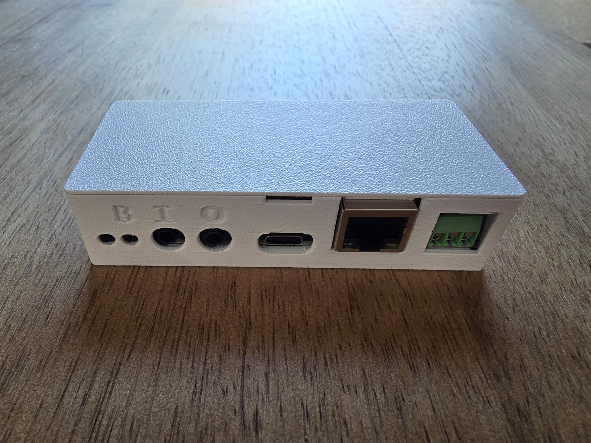
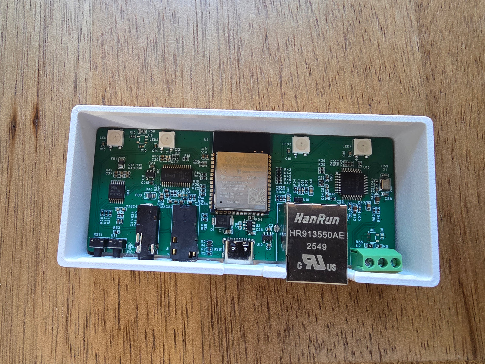

## Description

The Apollo CAST PRO-1 connects to your powered speakers, receiver or soundbar and adds them to your smart home. It shows
up in Home Assistant as an ESPHome media player and in Music Assistant as a player you can stream to, in sync with other
rooms over Sendspin. Streaming runs locally, with no cloud account and no subscription.

**Features:**

- Analog output (PCM5122 DAC) or optical output, picked with the **Audio Output** setting
- Line In for a turntable, TV or other source, available as a source in Music Assistant (PCM1808 ADC). Turn on the
  **Line In** switch to use it. While Line In streams, this unit plays through the optical output, not the analog one
- Ethernet on board (W5500) or Wi-Fi, with Ethernet taking priority when a cable is plugged in
- Terminals for an addressable LED strip (5V, GND and IO1), with no soldering
- 4 onboard RGB LEDs
- WizMote control, with each button configurable in Home Assistant
- ESP32-S3 with PSRAM
- Bluetooth proxy (off by default, turn on the **Bluetooth Proxy** switch)
- Improv Wi-Fi setup over Bluetooth or USB
- Firmware updates from Home Assistant, on a Stable or Beta channel

## Quickstart

1. Connect the CAST PRO-1 to your powered speakers, receiver or soundbar, then plug it in over USB-C.
2. For a wired connection, plug in an Ethernet cable. For Wi-Fi, connect to "Apollo CAST_PRO-1 Hotspot" and input your
   WiFi credentials, or set it up over Bluetooth with Improv.
3. In Home Assistant, look at discovered devices.
4. Pick the **Audio Output** setting on the device page.
5. Stream to it from Music Assistant (2.10.7 or newer).

## Configuration

Compiling this configuration yourself needs ESPHome 2026.11.0 or newer.

```yaml url=https://github.com/ApolloAutomation/CAST_PRO-1/blob/main/Integrations/ESPHome/CAST_PRO-1.yaml
```

## Links

- [Shop](https://apolloautomation.com/products/cast-1-pro)
- [GitHub](https://github.com/ApolloAutomation/CAST_PRO-1)
- [Web Installer](https://apolloautomation.github.io/CAST_PRO-1/)
- [Wiki](https://wiki.apolloautomation.com/products/castpro1/introduction/)
- [Discord](https://dsc.gg/ApolloAutomation)
- [YouTube](https://www.youtube.com/@ApolloAutomation)

## Product Images


