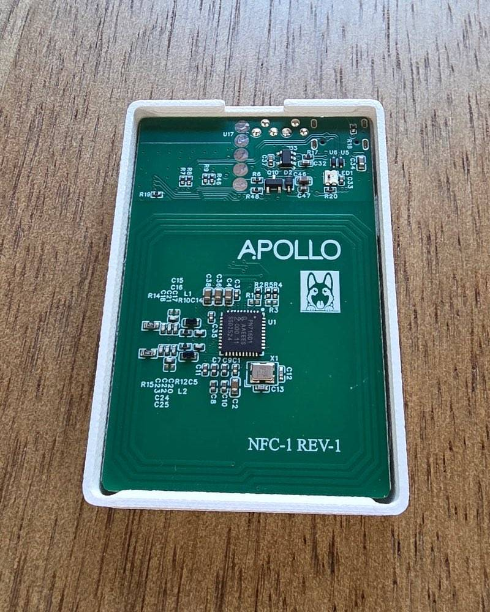
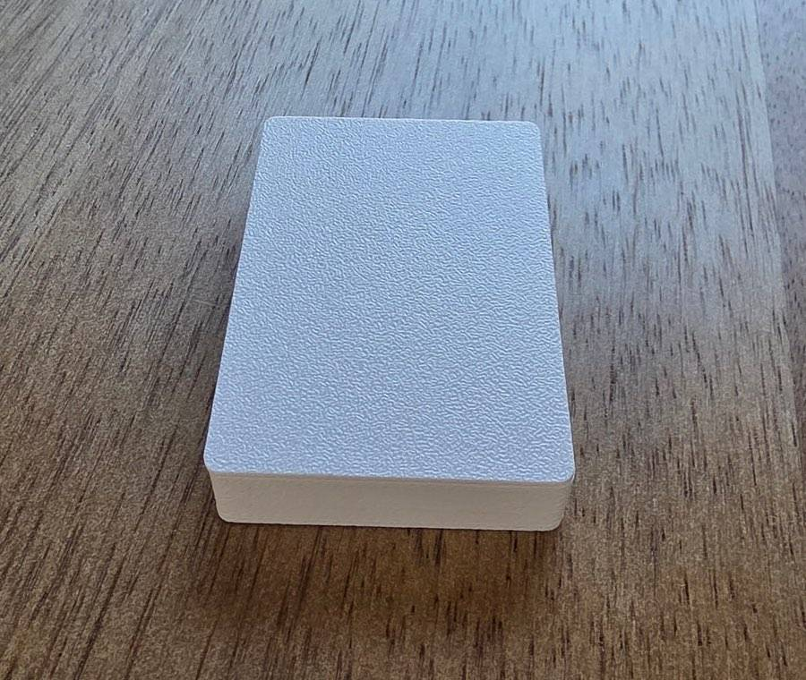

## Description

The Apollo NFC-1 is an NFC reader and writer for Home Assistant. Tags and cards you scan show up as Home Assistant
tags, ready to run an automation. It can also write URLs, text or new Home Assistant tags, clean or format tags so you
can reuse them, and act as a tag itself that most NFC-enabled phones can read.

**Features:**

- NXP PN7160 NFC controller, reading NTAG / MIFARE Ultralight and MIFARE Classic tags
- Scans arrive in Home Assistant as tag scans (**Settings > Tags**) and as an **NFC Event** entity, with **Last Tag**,
  **Last Tag UID** and **Last Tag Content** sensors
- Writes a URL, text or a new Home Assistant tag, and cleans or formats tags. Keep the tag on the reader afterwards:
  the NFC-1 reads it back to check the result and reports it in **Last Operation**
- Card emulation: the NFC-1 holds a URL that a phone can read with a tap. Off by default: set the **Emulation URL**,
  then turn on **Card Emulation**
- RGB LED and buzzer feedback, with volume and brightness settings. Turn off **LED Feedback** to use the **RGB Light**
  as a normal light (it still shows the connection status for 5 seconds at startup, and a button tap keeps it lit
  until the next tag scan)
- ESP32-C6 with 8MB flash and Wi-Fi
- Bluetooth proxy (off by default, turn on the **Bluetooth Proxy** switch)
- Improv Wi-Fi setup over Bluetooth or USB
- Firmware updates from Home Assistant, on a Stable or Beta channel

## GPIO Pinout

These pins are internal. They are listed for anyone writing their own configuration.

| Pin    | Function                                    |
| ------ | ------------------------------------------- |
| GPIO0  | I2C SDA (PN7160, address 0x28)              |
| GPIO1  | I2C SCL (PN7160)                            |
| GPIO5  | WS2812 RGB LED                              |
| GPIO6  | Buzzer (LEDC PWM)                           |
| GPIO9  | Button (status / factory reset, active low) |
| GPIO21 | PN7160 DWL_REQ                              |
| GPIO22 | PN7160 IRQ                                  |
| GPIO23 | PN7160 VEN                                  |

## Quickstart

1. Plug the NFC-1 in over USB.
2. Connect it to Wi-Fi in one of these ways:
   - Let Home Assistant find it over Bluetooth with Improv (this needs Bluetooth in Home Assistant) and input your
     Wi-Fi credentials.
   - Use the [web installer](https://apolloautomation.github.io/NFC-1/) over USB.
   - Connect to "Apollo NFC1 Hotspot" and input your Wi-Fi credentials.
3. In Home Assistant, look at discovered devices and add the Apollo NFC-1.
4. Scan a tag. It appears under **Settings > Tags**, ready to use in an automation. Phones and cards with a random
   `08-` UID change it on every tap, so the NFC-1 leaves them out of **Settings > Tags**.

To write a URL, type it into **Write URL** first. To write, clean or format a tag, pick the task with the **Mode**
select or press **Write URL Tag**, **Write New HA Tag**, **Clean Tag** or **Format Tag**, then hold a tag to the NFC-1.

## Actions

The NFC-1 adds these actions to Home Assistant, so automations can drive it. Each one is named after the device, for
example `esphome.apollo_nfc_1_xxxxxx_write_url`, where `xxxxxx` is the end of its MAC address:

- `write_url`, `write_text` and `write_ha_tag`: write to the next tag. An empty `tag_id` writes a new random
  Home Assistant tag
- `clean_tag`, `format_tag` and `cancel_tag_operation`
- `set_emulation_url`: change the URL that card emulation shares
- `play_buzzer`: play an RTTTL tune

## Configuration

Compiling this configuration yourself needs ESPHome 2026.10.1 or newer.

```yaml url=https://github.com/ApolloAutomation/NFC-1/blob/main/Integrations/ESPHome/NFC-1.yaml
```

## Links

- [Shop](https://apolloautomation.com/products/nfc-1-nfc-reader-writer-and-emulator)
- [GitHub](https://github.com/ApolloAutomation/NFC-1)
- [Web Installer](https://apolloautomation.github.io/NFC-1/)
- [Wiki](https://wiki.apolloautomation.com/products/nfc1/introduction/)
- [Discord](https://dsc.gg/ApolloAutomation)
- [YouTube](https://www.youtube.com/@ApolloAutomation)

## Product Images


