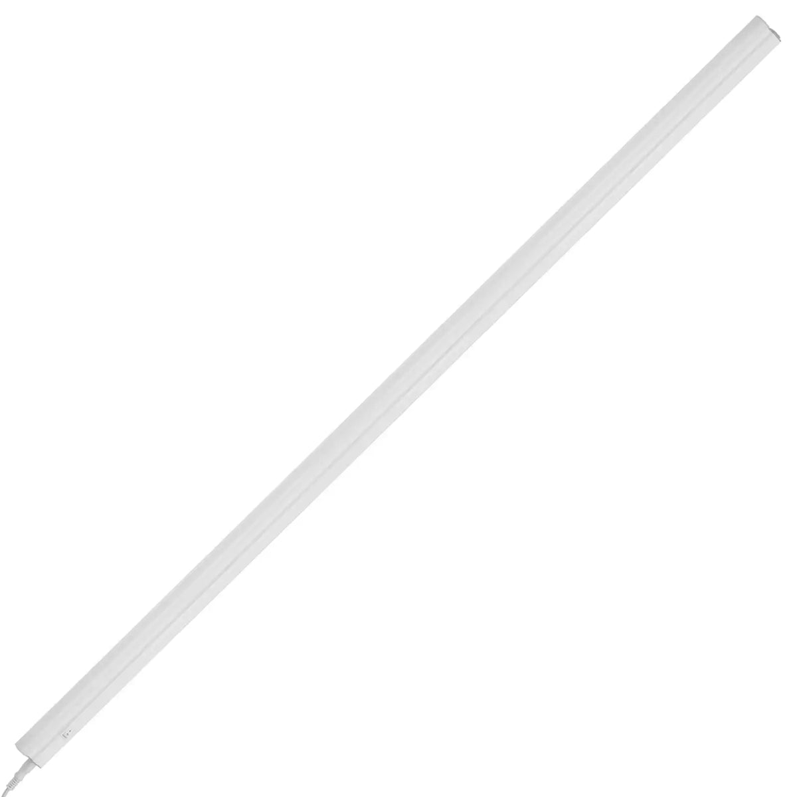

Product image: [Arlec UC552HA](https://www.arlec.com.au/products/arlec-white-12w-87cm-grid-connect-smart-linkable-cct-bar-light).

The `Arlec Grid Connect Smart 87cm Linkable CCT Bar Light` is part of the
[Grid Connect ecosystem](https://grid-connect.com.au/) sold at Bunnings in Australia and uses the
Tuya [CBLC9](https://developer.tuya.com/en/docs/iot/cblc9-module-datasheet?id=Ka42cqnj9r0i5) module.
This module is a variant of the BK7231 family and must be re-flashed or replaced with an ESP8266
series module which fits inside the housing.

The light is simply a CCT LED light strip mounted inside a plastic diffuser tube, but does come with
useful mounting hardware.

This installation replaces the CBLC9 with an ESP8285, using soldered fly leads between the controller
board and ESP8285, however a re-flash of the CBLC9 is likely also possible, which would allow for the
same module to be removed, re-flashed, and re-installed.

## GPIO Pinout for ESP8285

| CBLC9 Pin | ESP8285 Pin | Function           |
| --------- | ----------- | ------------------ |
| P8        | GPIO13      | PWM `(brightness)` |
| P7        | GPIO5       | PWM `(color_temp)` |

## Conversion

The light assembly is glued together at either end using white silicone glue. The end where the power
plug is connected must be slightly ground down around the edges so that a long slim spudger tool can be
inserted between the end cap and the housing about 5cm depth. This allows the silicone glue bond to be broken.
The control module can be slid out far enough to de-solder the CBLC9 module and the ESP8285 then soldered to
the 3.3V, GND, P8 and P7 pads.

## Configuration

The example contains the device hardware settings. Add your Wi-Fi, API and OTA configuration separately.

```yaml file=config.yaml
```
