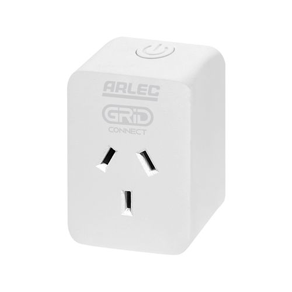

The Arlec PC191HA power plug is part of the [Grid Connect ecosystem](https://grid-connect.com.au/) and is sold at
Bunnings in Australia and New Zealand.
These are available in White (PC191HA) or Black (PC191BKHA), and in 4-packs of White and Black - which are identical.
It is compact, easily fitting side-by-side in double wall sockets.

The Arlec Grid Connect Smart Plug In Socket With Energy Meter uses a WB2S module with BK7231T chip (a variant of bk72xx)
and is supplied with Tuya firmware.
As at the time of writing, they can be flashed without disassembly or soldering [using cloudcutter](#using-cloudcutter).

### Series 2 Info

From approx. May 2023 Bunnings is now selling "series 2" units, which _may_ use a CB2S module. These are clearly
labelled as series 2 in bottom right corner of the box, and on the unit, however these is no external indication of what
module is inside. It appears the only way to tell is based on the Tuya firmware version. Best to match the firmware
versions with the cloudcutter profiles:

- v1.1.8: CB2S
- v1.3.5: WB2S

**Update 11 August 2024:** Bunnings are now selling "Series 3" units with the same part number (PC191HA, or PC191BKHA
for the black units). These continue to use the CB2S module but are loaded with Tuya firmware version 1.1.17 which isn't
vulnerable to the Cloudcutter exploit. Additionally, the PCB design has been changed, and the GPIO configuration has
subsequently changed - see the GPIO pinout table for the Series 3 unit below.

Bunnings also have similar-looking Arlec Grid Connect variations: - PC192HA with USB, - PCTH01HA with Temperature And
Humidity Sensor, - PC287HA Twin Socket with Energy Meter and Surge Protection, - PC193HA Multi-Function Socket With USB
I have NOT looked at any of these variations to find out if they are similar to PC191HA.

## GPIO Pinout

| Pin | Function                             |
| --- | ------------------------------------ |
| P6  | (PWM0) Relay                         |
| P7  | (PWM1) BL0937 CF pin                 |
| P8  | (PWM2) BL0937 CF1 pin                |
| P24 | (PWM4) BL0937 SEL pin                |
| P26 | (PWM5) LED                           |
| P10 | (RXD1) Wifi LED (hidden inside unit) |
| P11 | (TXD1) Button                        |

## GPIO Pinout - Series 3

| Pin | Function                             |
| --- | ------------------------------------ |
| P6  | (PWM0) BL0937 CF1 pin                |
| P7  | (PWM1) BL0937 CF pin                 |
| P8  | (PWM2) Relay                         |
| P10 | (RXD1) Wifi LED (hidden inside unit) |
| P11 | (TXD1) Button                        |
| P24 | (PWM4) BL0937 SEL pin                |
| P26 | (PWM5) LED                           |

## Getting it up and running

### Using Cloudcutter

Cloudcutter is a tool that simplifies flashing Tuya-based devices. It allows you to flash the firmware over Wi-fi,
eliminating the need to physically open the device.
Follow [these instructions](https://github.com/tuya-cloudcutter/tuya-cloudcutter) to flash your Arlec PC1914HA device
using Cloudcutter.
After that, you can use ESPHome's OTA functionality to make any further changes.

### Series 3 - flashing the CB2S module manually

The case is ultrasonic-welded shut. With a spudger, blade, or other thin-edged tool you can pry it open (there will be
some cosmetic damage). There will also be some silicone holding everything together which can be overcome with some
effort. The CB2S module is soldered in a thru-hole configuration on the top edge of the main board. Refer to the
[CB2S datasheet](https://developer.tuya.com/en/docs/iot/cb2s-module-datasheet?id=Kafgfsa2aaypq)
for its pinout, you'll need a USB to
TTL serial adapter and a soldering iron. It's best to remove the module from the main board, as the serial adapater's
3.3V power supply probably isn't enough for the module to boot with peripherals attached. Flash with
[ltchiptool](https://github.com/libretiny-eu/ltchiptool) or similar.

### Note on Power Monitoring

Power measurement uses the BL0937 chip, which is similar to HLW8012 except CF and CF1 are inverted.
I found that setting current_resistor to give an accurate Amperage does NOT also give the correct Wattage, so instead I
calculate current from power and voltage.

### After firmware update

After a firmware update the device will reboot, but using the OLD firmware.
To activate the new firmware you will have to disconnect the device from power for a while.
When you reconnect the device it may activate the new firmware (which could take a couple of minutes) before connecting
to Wi-fi. If it does not, simply power it off for a longer time (I have waited >6 hours powered off for one of these
pesky devices to activate firmware).

## Basic Configuration

The examples contain the device hardware settings. Add your Wi-Fi, API and OTA configuration separately.

```yaml file=config.yaml
```

## Series 3 Configuration

```yaml file=series-3-configuration.yaml
```

### Calculated current

Combine this fragment with either of the BK7231 configurations above to calculate current from power and voltage.

```yaml file=calculated-current.yaml
```

## ESP8266 configuration

The BK7231 module is not suitable for devices which must remain powered after OTA or any reboot cycle, as these modules
have no capability to keep power applied during a reboot. Replacing the WB2S or CB2S modules with an ESP8285 based
module resolves this issue, and any ESP-02S form factor module will suffice, with the most commonly available modules
being the Tuya TYWE2S. The ESP8285 also uses a more standardised configuration for power monitoring, without needing any
of the complexity applied in the BK7231 configuration related to the BL0937 chip.

The BL0937 calibration values were validated using a CCI Power-Mate monitoring a heat gun pulling 1800 watts.

```yaml file=esp8266-configuration.yaml
```

## References

- [Elektroda forum discussion][pc191ha-forum] - breakdown of PC191HA and discussion, including about series 2
- [Blakadder template][pc191ha-blakadder] - TASMOTA definition, which advises replacing the WB2S module
- [Home Assistant energy consumption thread][pc191ha-ha-energy]
- [Home Assistant Kickstart discussion][pc191ha-ha-kickstart] - Discussion about series 2 containing different modules

[pc191ha-forum]: https://www.elektroda.com/rtvforum/topic3944452.html
[pc191ha-blakadder]: https://templates.blakadder.com/arlec_PC191HA.html
[pc191ha-ha-energy]: https://community.home-assistant.io/t/335508/55
[pc191ha-ha-kickstart]: https://community.home-assistant.io/t/701658
