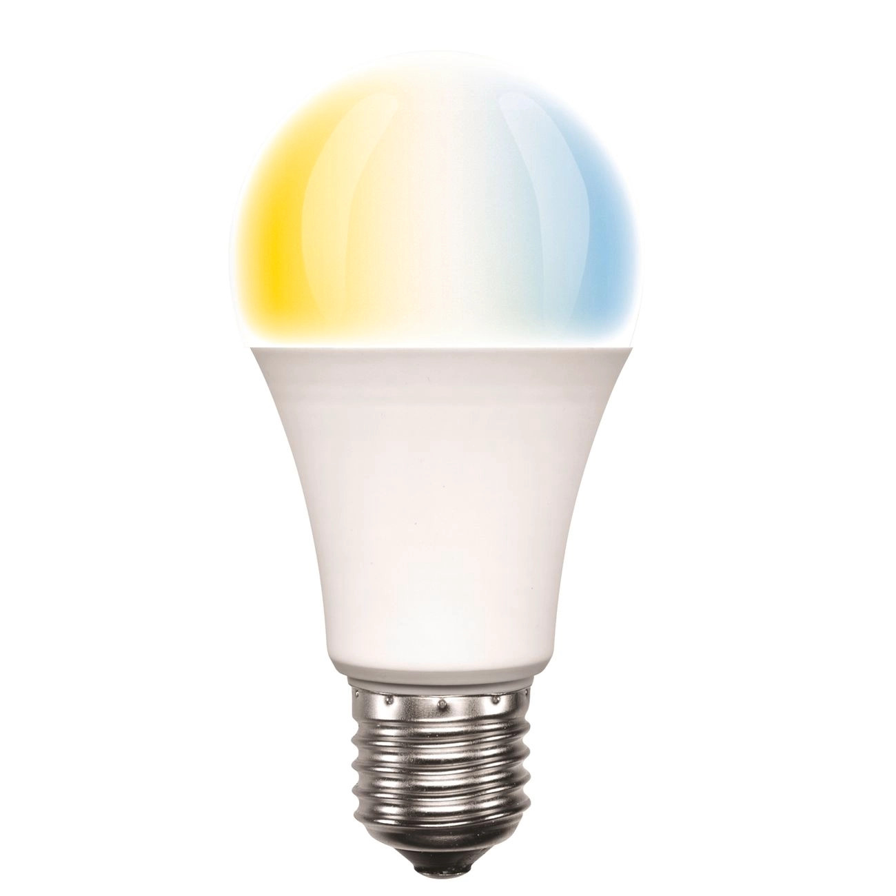

## Device Info

This light globe is sold is Australia. SKU: 20696/20874

- [Bunnings](https://www.bunnings.com.au/brilliant-8-5w-a60-e27-warm-white-daylight-led-smart-globe_p0137909)

## GPIO Pinout

| Pin    | Function                     |
| ------ | ---------------------------- |
| GPIO12 | Warm white color temperature |
| GPIO14 | Cold white color temperature |

## Basic Configuration

The example contains the device hardware settings. Add your Wi-Fi, API and OTA configuration separately.

```yaml file=config.yaml
```
