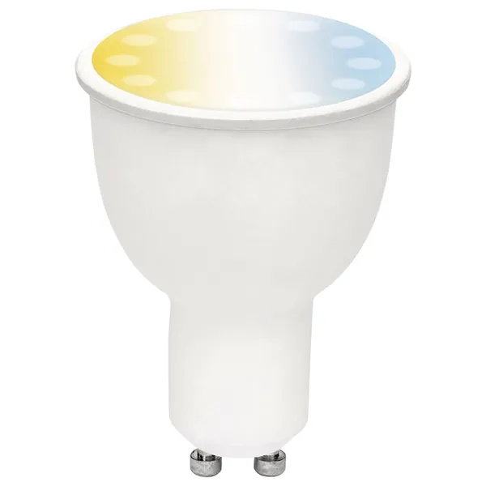

## General Notes

Brilliant Smart CCT Globe GU10 sold at OfficeWorks, part number BL20887. Provides adjustable brightness and white colour
temperature (cool to warm). Based on the ESP8266 platform by way of independent PWM control of a warm LED and a cool
LED.

[Hardware reference for model 20887](https://templates.blakadder.com/brilliantsmart_20887.html).



## GPIO Pinout

| Pin     | Function                           |
|---------|------------------------------------|
| GPIO5   | PWM Light - cool white             |
| GPI12   | PWM Light - warm white             |

## Basic Configuration

Notes on the configuration code:

- Customize the names in `substitutions` to suit your needs
- If the brightness is set too low, the globe will go out. Looking into a solution for this
- Colour temperatures in code are a guess

```yaml file=config.yaml
```

## Optional features

Download the selected YAML files into the same directory and include them as local packages alongside `config.yaml`.
Add your Wi-Fi credentials in your own configuration.

Home Assistant API and OTA updates:

```yaml file=home-assistant.yaml
```
