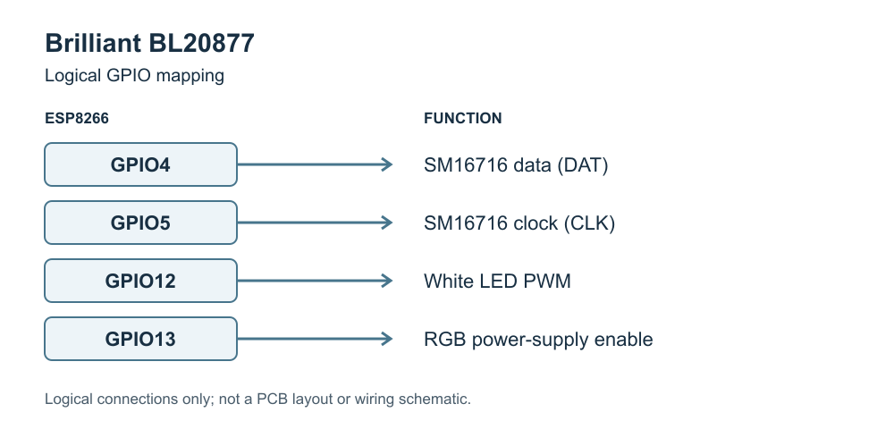

## General Notes

This page covers the Brilliant Smart RGB and White Globe B22, Officeworks product code BL20877.
The [archived Officeworks listing][officeworks] describes this model.



Original GPIO diagram based on the pinout below, distributed under the repository's GPL-3.0 license.
The [editable SVG source](brilliant-bl20877-gpio.svg) is included. This is a logical mapping, not a PCB layout.

## GPIO Pinout

| Pin     | Function                           |
|---------|------------------------------------|
| GPIO4   | SM16716 Data Pin                   |
| GPIO5   | SM16716 Clock Pin                  |
| GPIO12  | PWM Light - White                  |
| GPIO13  | SM16716 Power Supply               |

## Basic Configuration

```yaml file=config.yaml
```

## Optional Home Assistant integration

Download both YAML files into the same directory and include them as local packages in your ESPHome configuration.
Add your Wi-Fi credentials in your own configuration. This optional file enables the Home Assistant API and OTA updates.

```yaml file=home-assistant.yaml
```

[officeworks]: https://web.archive.org/web/20200930162316/https://www.officeworks.com.au/shop/officeworks/p/brilliant-smart-rgb-and-white-globe-b22-bl20877
