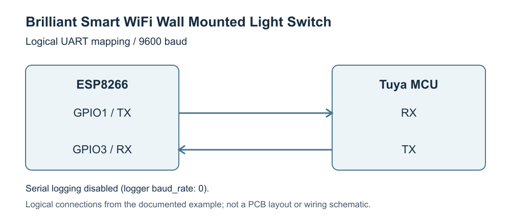

The Brilliant Smart WiFi wall mounted light switch is available in Australia. They come in single gang, twin, triple and
quad gang configurations. They're a smooth glass front with round touch switches to control the lights.

## Getting Started

These devices are obstensibly Tuya-controlled switches, but after re-flashing them with Tuya-Convert, they work
nicely with ESPHome. I flashed mine directly from the existing Tuya to ESPHome. (Some people go to Tasmota first –
there's no need.)

[Archived ESPHome and Tuya flashing guide][flashing-guide] by Kieren Anderson.
This is a historical guide; use the current ESPHome component documentation below for configuration.

## UART connection



Original diagram based on the existing example, distributed under the repository's GPL-3.0 license.
The [editable SVG source](brilliant-switch-uart.svg) is included. It shows logical connections, not a PCB layout.

| ESP8266 pin | Function                     |
| ----------- | ---------------------------- |
| GPIO1       | UART TX to Tuya MCU           |
| GPIO3       | UART RX from Tuya MCU         |

The UART connection runs at 9600 baud. Serial logging is disabled to leave these pins available to the Tuya MCU.

## Basic configuration

This YAML is cobbled together from:

- [DETA Grid Connect Smart Switch template][brilliant-deta] (for the WiFi signal and uptime sensors and the restart
  option)
- [ESPHome Tuya component documentation][brilliant-tuya]
- [ESPHome Tuya switch documentation][brilliant-tuya-switch]

[flashing-guide]: https://web.archive.org/web/20211201185131/https://thehomeautomator.com.au/running-esphome-with-home-assistant/
[brilliant-deta]: https://devices.esphome.io/devices/DETA-Grid-Connect-Smart-Switch/
[brilliant-tuya]: https://esphome.io/components/tuya/
[brilliant-tuya-switch]: https://esphome.io/components/switch/tuya/

```yaml file=config.yaml
```

The example controls a single-gang switch with Tuya datapoint 1. The original example also lists datapoints 2, 3
and 4 for additional gangs. Confirm the datapoints reported by your device before adding further Tuya switches.

## Optional Home Assistant integration and diagnostics

Download both YAML files into the same directory and include them as local packages in your ESPHome configuration.
Add Wi-Fi credentials and any API encryption settings in your own configuration. This optional file enables the
Home Assistant API, OTA updates, the captive portal, Wi-Fi signal and uptime sensors, and the restart switch.

```yaml file=home-assistant.yaml
```
