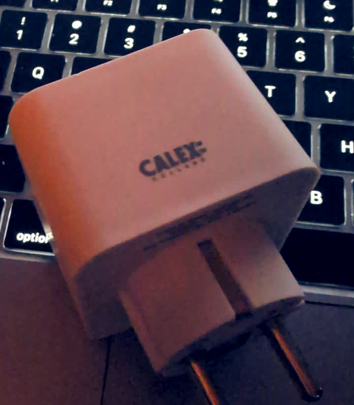
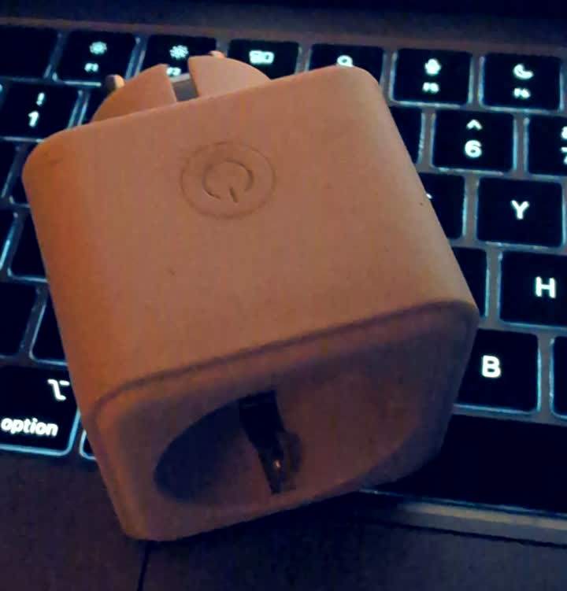
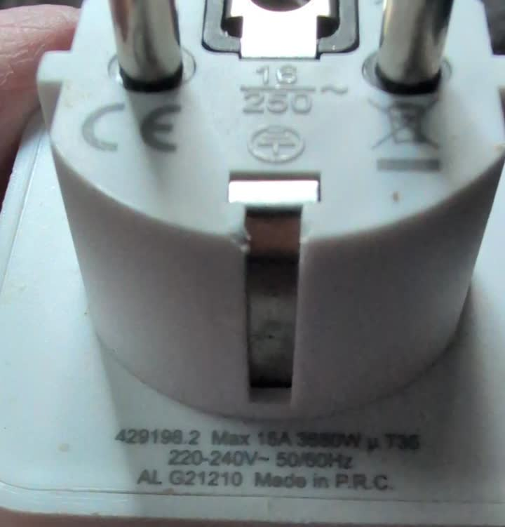

## Product Description

The [Calex](https://www.calex.eu/) **Smart Power Plug 16A EU** (Electro Cirkel article `429198.2`, e.g. batch
`AL G21210`) is a 16A / 3680W grounded Schuko smart plug sold across the Netherlands and Europe (Action, Gamma, Praxis,
Bol). Unlike the energy-meter variant (`429201`), SKU `429198.2` is a pure 16A relay switch board
(`oem_bk7231s_rnd_switch`) built around a Tuya [WB2S](https://docs.libretiny.eu/boards/wb2s/) (`BK7231T`) module
supported by [ESPHome LibreTiny (`bk72xx`)](https://esphome.io/components/libretiny/), without a power-metering IC
populated.

Units on factory firmware **`1.1.2`** (`1.1.2 - BK7231T / oem_bk7231s_rnd_switch`) can be flashed wirelessly with
[tuya-cloudcutter](https://github.com/tuya-cloudcutter/tuya-cloudcutter) using an ESPHome Kickstart UF2 image without
opening the enclosure; units updated to newer patched TuyaOS firmware require 3.3V UART serial flashing (`3V3`, `GND`,
`RX1`, `TX1`).

> **Wi-Fi tip (`BK7231T`):** Set your 2.4 GHz IoT SSID to pure **WPA2-PSK (`CCMP`)** with PMF (`802.11w`) disabled if
> you see periodic reconnects on WPA2/WPA3 transitional networks.

## GPIO Pinout

| Pin | Function                             |
| --- | ------------------------------------ |
| P6  | Red Relay LED (active-high)          |
| P7  | Push Button (inverted, pull-up)      |
| P8  | 16A Relay (active-high)              |
| P26 | Blue Wi-Fi Status LED (active-high)  |

## Basic Configuration

```yaml file=config.yaml
```

## Product Images



