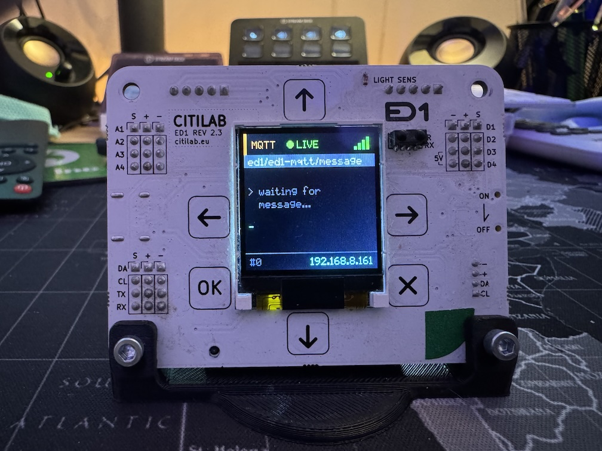

The **ED1** is an educational development board based on the **ESP32**, created by
[Citilab Edutec](https://market.citilab.eu/en/producte/ed1-board/). It is designed to teach embedded systems,
programming, and IoT.

It features a built-in 1.44" TFT display, capacitive touch buttons, sensors (light,
temperature), and expansion ports for controlling stepper motors (28BYJ-48) and
WS2812 LED matrices.



## Features

* **MCU:** ESP32-SIP (Dual-core 240MHz, WiFi, BLE)
* **Display:** 1.44" TFT LCD (ST7735, 128x128 pixels)
* **Input:** 6 Capacitive Touch Buttons (Up, Down, Left, Right, OK, X)
* **Audio:** Passive Buzzer with amplifier (PAM8301)
* **Sensors:**
  * Light Sensor (ALS-PT19-315C)
  * IR Receiver (38kHz)
  * Internal Temperature & WiFi Signal
* **Power:** USB-C (5V) and Li-Ion Battery (16340) charger
* **Expansion:**
  * **Stepper Motors:** I2C Expander (MCP23009) + ULN2004A drivers for 2x 28BYJ-48
  * **LED Matrix:** Dedicated port for WS2812 32x8 matrix
  * **I2C/UART:** Grove connector and pin headers

## Configuration

The following configuration enables the display, buttons, buzzer, and basic sensors.

> **Note:** For advanced features like stepper motors (which use direct I2C register
> manipulation via MCP23009) or complex display layouts, consider using external
> packages or custom components as seen in the
> [project repository](https://github.com/glifocat/ed1-hoas).

The example contains the device hardware settings. Add your Wi-Fi, API and OTA configuration separately.

```yaml file=config.yaml
```

### Optional buzzer test

Merge this fragment with the hardware configuration to add the example buzzer test switch.

```yaml file=buzzer-test.yaml
```

## References

* [Official Citilab ED1 Product Page](https://market.citilab.eu/en/producte/ed1-board/)
* [ED1 Home Assistant Project (GitHub)](https://github.com/glifocat/ed1-hoas)
