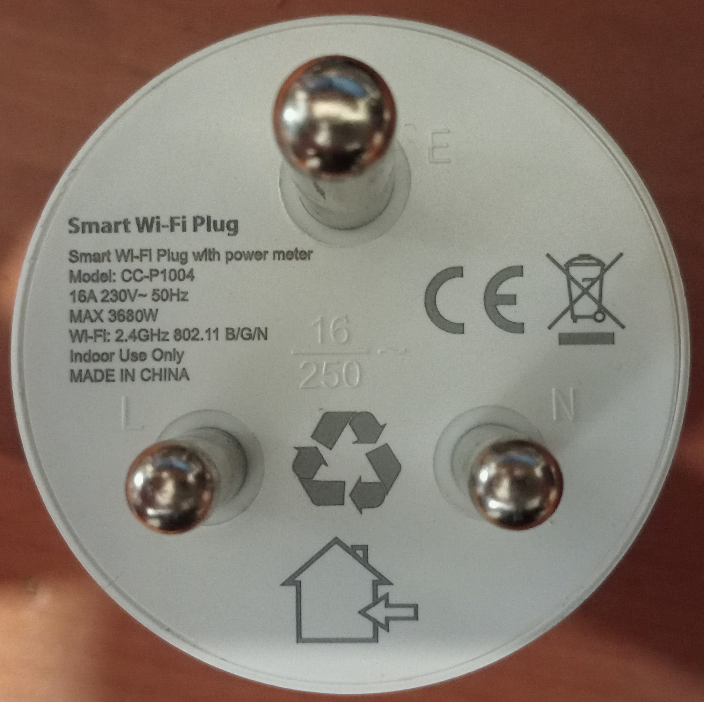
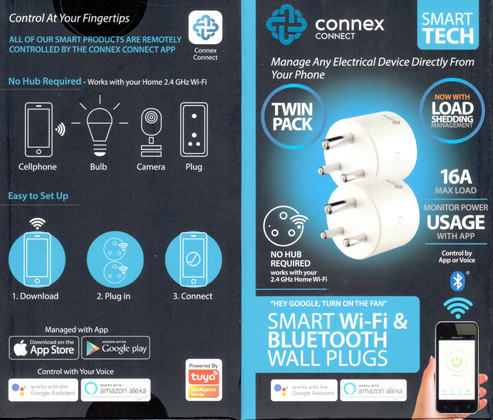
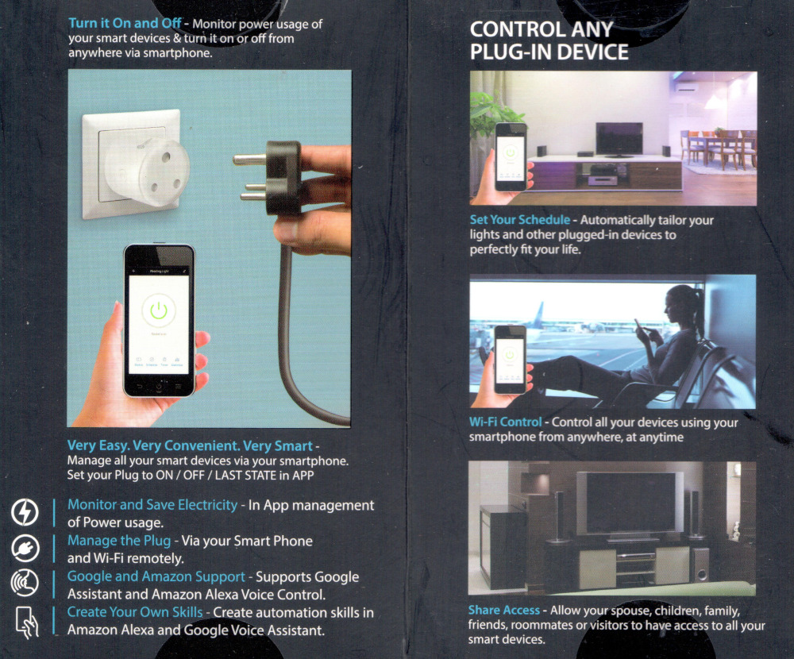

This is a South African Type M, 16 A smart plug with power monitoring, sometimes sold as a twin pack.
[Manufacturer product page](https://connexconnect.com/product/smart-wifi-plug-3-pin-sa-round-16a/)

Its instructions say to use the [Connex Connect](https://play.google.com/store/apps/details?id=com.smd.connex.connect)
app, which is clearly just a white-labeled version of
the [Tuya Smart](https://play.google.com/store/apps/details?id=com.tuya.smart) app.

It uses a WB2S / BK7231T module.
This was identified from retained Tuya configuration without opening the case.

The plug itself is labeled CC-P1004, but Tuya identifies it as CC-P1003.

## Flashing

Stock firmware 1.3.5 was successfully flashed over Wi-Fi using CloudCutter's
`arlec-pc191ha-smart-plug-bk7231t-v1.3.5` profile
([compatibility report](https://github.com/tuya-cloudcutter/tuya-cloudcutter/issues/930))
on 2026-11-03.

I had to enter slow-blinking AP pairing mode before starting:

- Hold the button until it clicks, then release. The LED will start blinking fast.
- Again, hold the button until it clicks, then release. The LED will start blinking slow (about 1s on, 1s off).
  - One of my plugs blinked 1s red, 1s off. The other plug blinked 1s red, 1s blue. I don't know why they differ.

This uses the same exploit as the Arlec profile, but its relay, button and LED assignments differ.

Other firmware and hardware revisions have not been tested.

## GPIO pinout

| Pin | Function           |
|-----|--------------------|
| P6  | LED, active low    |
| P7  | `BL0937` CF        |
| P8  | `BL0937` CF1       |
| P10 | Button, active low |
| P24 | `BL0937` SEL       |
| P26 | Relay, active high |

`BL0937` refers to the [energy metering IC](https://www.lcsc.com/datasheet/C94616.pdf).

## Configuration

Tested with ESPHome 2026.10.2 and LibreTiny 1.13.0, including Home Assistant relay control and power monitoring.
The LED is configured as a Wi-Fi status indicator, not a relay indicator.
Meter calibration below is an example from one unit, aligned against a second plug's stock
readings. Calibrate each unit; absolute meter accuracy was not independently verified.

```yaml file=config.yaml
```
