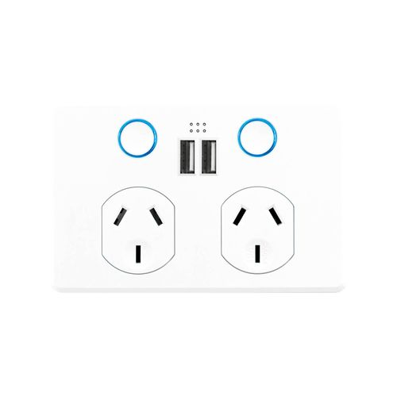

## Deta Grid Connect Smart Double Touch Power Point With Dual USB

Manufactured by [Deta](https://detaelectrical.com.au/),
this is a AU/NZ standard wall outlet/powerpoint with USB charging ports based on the Beken BK7231T module. Now that
ESPHome natively supports BK72XX microcontrollers, you can also put ESPHome directly onto the device.



Photo from [Tuya Cloudcutter][cloudcutter-photo], distributed with its [MIT licence](LICENSE-cloudcutter.txt).
Cloudcutter also maintains a [6920HA Double Touch Outlet v1.0.6 device record][cloudcutter-device].

## Getting it up and running

### Using Cloudcutter

[Cloudcutter](https://github.com/tuya-cloudcutter/tuya-cloudcutter) is a tool designed to simplify the process of
flashing Tuya-based devices. It allows you to bypass the need for physically opening the device and swapping out chips.
By leveraging the cloud APIs, Cloudcutter enables you to flash the firmware remotely, making it a convenient and less
intrusive option. Follow the instructions on the
[Cloudcutter GitHub repository](https://github.com/tuya-cloudcutter/tuya-cloudcutter) to use this method for flashing
your Deta 6920HA device.

### Disassembly

If you can't or don't wish to use Cloudcutter, you can flash directly to the outlet with USB to serial adapter.

To disassemble the outlet in order to flash, remove the front plastic face (secured by clips on each side),
then remove the two exposed screws. Remove the clear panel and then carefully remove the small thin PCB
that sat underneath the panel.

## GPIO pinout

| GPIO # |   Component   |
|:------:|--------------:|
| P8     |    Status LED |
| P10    |     Sensor Rx |
| P7     |      Button 1 |
| P24    |      Button 2 |
| P6     |       Relay 1 |
| P26    |       Relay 2 |

## Basic Configuration

```yaml file=config.yaml
```

## Optional features

Download the selected YAML files into the same directory and include them as local packages alongside `config.yaml`.
Add your Wi-Fi credentials in your own configuration.

### Home Assistant and daily energy

This adds the Home Assistant API, OTA updates, captive portal and daily energy totals using Home Assistant time.

```yaml file=home-assistant.yaml
```

### Buttons and relay indicator

This preserves the physical buttons' relay controls and the indicator linked to the right-hand relay.

```yaml file=button-controls.yaml
```

[cloudcutter-photo]: https://github.com/tuya-cloudcutter/tuya-cloudcutter.github.io/blob/5b2568fac752874874eda22565305ca910c1d950/images/deta-6920ha-double-touch-outlet-v1.0.6.jpg
[cloudcutter-device]: https://github.com/tuya-cloudcutter/tuya-cloudcutter.github.io/blob/5b2568fac752874874eda22565305ca910c1d950/devices/deta-6920ha-double-touch-outlet-v1.0.6.json
