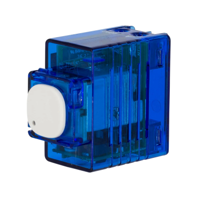
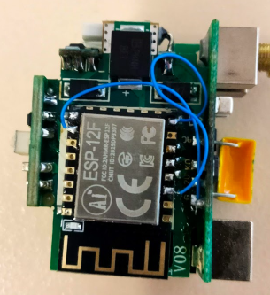

## General Notes

A smart switch that does not require a neutural, needs a minumum 20w load or a [load correction device](https://www.clipsal.com/products/detail?CatNo=31LCDA&itemno=31LCDA&tab-document-1=0)

Available from [Bunnings](https://www.bunnings.com.au/deta-smart-switch-mechanism_p0346912)



## GPIO Pinout

| Pin    | Function                  |
| ------ | ------------------------- |
| GPIO12 | Blue LED (Inverted: true) |
| GPIO14 | Button                    |
| GPIO16 | Relay                     |

## Conversion

To use ESPHome, replace the WB3S with a ESP12F.

- Link GPIO15 to Gnd (recommended via 10k resistor)
- Link EN to Vcc (recommended via 10k resistor)

Due to limited space, conversion below ommited the resistors. No issues but it is outside specifications.


## Configuration

```yaml
substitutions:
  name: "deta-6014-01"
  friendly_name: "DETA 1G"
  project_name: "DETA.60141HA"
  project_version: "1.0"
  device_description: "Deta 6014HA Light Switch"

esphome:
  name: "${name}"
  comment: "${device_description}"
  project:
    name: "${project_name}"
    version: "${project_version}"

esp8266:
  board: esp12e
    
# OTA flashing
ota:
  - platform: esphome

wifi: # Your Wifi network details
  
# Enable fallback hotspot in case wifi connection fails  
  ap:

# Enabling the logging component
logger:

# Enable Home Assistant API
api:

# Enable the captive portal
captive_portal:

output:
  # Button
  - platform: gpio
    pin: GPIO16
    id: relay1

light:
  # Top (or only) button
  - platform: binary
    name: "${friendly_name} Light"
    output: relay1
    id: light1
    on_turn_on:
      - light.turn_on: status1
    on_turn_off:
      - light.turn_off: status1
  - platform: status_led
    id: status1
    pin:
      number: GPIO12
      inverted: true

# Buttons
binary_sensor:
  # Button
  - platform: gpio
    pin:
      number: GPIO14
      mode:
        input: true
        pullup: true
      inverted: True
    name: "${friendly_name} Button"
    #toggle relay on push
    on_press:
      - light.toggle: light1

button:
  - platform: restart
    id: restart_button
    name: "${friendly_name} Restart"
    disabled_by_default: true

```
