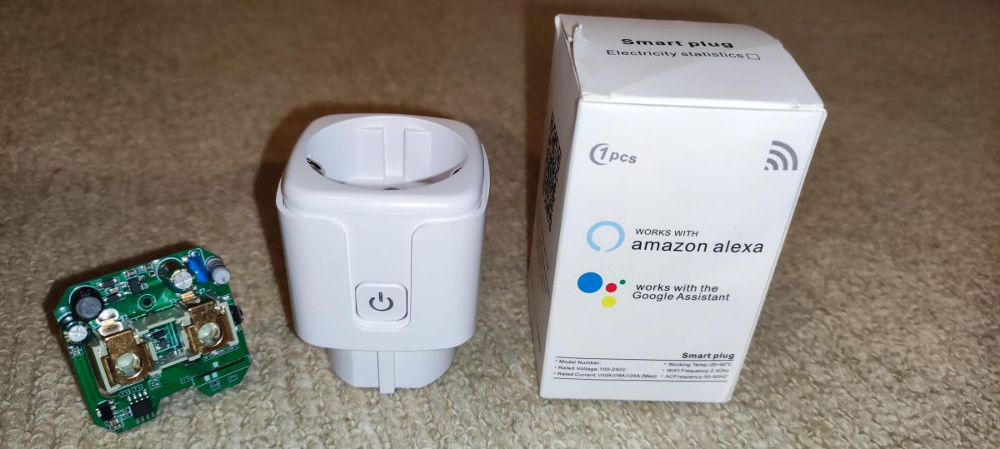

Photo: [divadiow's teardown](https://www.elektroda.com/rtvforum/topic4032920.html).

Bought from: [AliExpress](https://de.aliexpress.com/item/1005005374840269.html)

Board/Pinout: [libretiny.eu](https://docs.libretiny.eu/boards/t102-v1.1/#pinout)

Pictures: [elektroda.com](https://www.elektroda.com/rtvforum/topic4032920.html) (Pinout picture is off, uart2 is on the
two unconnected pads labled 0/12.)

Due to a bug [libretiny-eu/libretiny#227](https://github.com/libretiny-eu/libretiny/issues/227) the board w2 needs to be
selected for the relay to work:
Due to another bug you need to apply this fix to platforms\libretiny@1.4.1\cores\realtek-amb\arduino\src\wiring_irq.c
[https://github.com/libretiny-eu/libretiny/issues/155#issuecomment-1826470433](https://github.com/libretiny-eu/libretiny/issues/155#issuecomment-1826470433)

## Chips used

McuBoard: [T102_V1.1](https://docs.libretiny.eu/boards/t102-v1.1/)

MCU: RTL8710BX

Flash: GD25Q16ETIG 2 M x 8 NOR Flash

Power Sensor: [BL0937](https://developer.tuya.com/en/docs/iot-device-dev/Electricity-statistics?id=Kaunfo4am6icc)

Relay:
[JIEYING JY3FF-S-DC5V-A(K)](https://wmsc.lcsc.com/wmsc/upload/file/pdf/v2/C17702442.pdf)

## Flashing

Hook up 3v3 and GND

Connect TX2 and RX2 to serial interface.

Short TX2 to GND during power on, then flash via
[ltchiptool](https://docs.libretiny.eu/docs/flashing/tools/ltchiptool/).

Can be flashed in-place without desoldering.

## GPIO Pinout

| Pin  | Function                  |
| ---- | ------------------------- |
| PA00 | BL0937 cf_pin             |
| PA05 | LED (Inverted)            |
| PA12 | BL0937 cf1_pin            |
| PA14 | BL0937 sel_pin (Inverted) |
| PA15 | Relay & LED2              |
| PA18 | Button (Inverted)         |

## platformio.ini

```ini
[env:wr2]
platform = libretiny
board = wr2
framework = arduino
```

## Basic Configuration

The example contains the device hardware settings. Add your Wi-Fi, API and OTA configuration separately.

```yaml file=config.yaml
```

### Daily energy

Combine this fragment with the hardware configuration above to retain the daily energy sensor and Home Assistant time.

```yaml file=daily-energy.yaml
```
