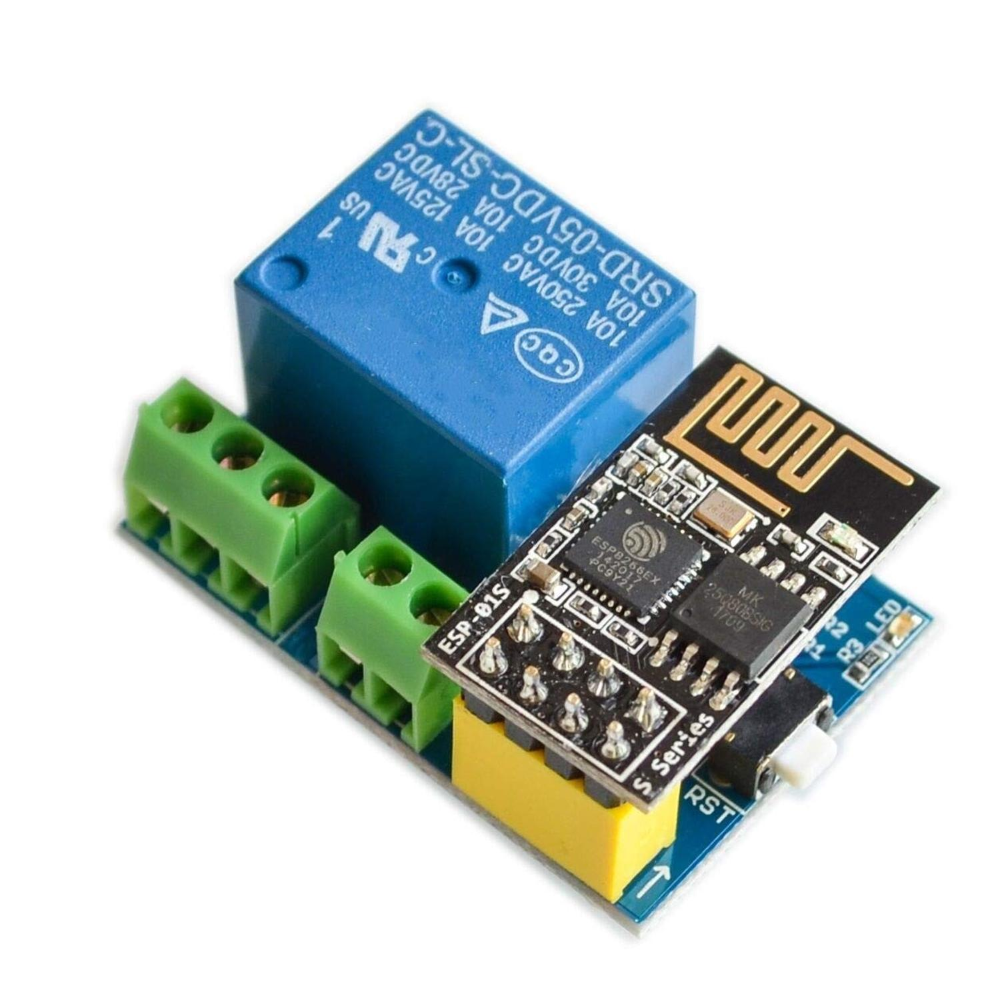

## Product description

This is a 5V 1-relay board with an ESP-01S.

The relay has COM+NO+NC exposed.

Working voltage: DC 5V

Relay Load: 10A 250VAC 10A 125VAC 10A 30VDC 10A 28VDC.

Available on UK Amazon, eBay and Aliexpress, very cheap and small

Size:approx. 36 x 25 x 16MM/1.4 x 0.9 x 0.6inch

ESP-01S is removable with 4x2 header, cheap USB adapters available, but GND and GPIO0 needs connecting for flashing

Config has a few more additions than basic

## Basic Config

```yaml
substitutions:
  # Modify variables based on your settings
  hostname: "heart"
  devicename: heart light

esphome:
  name: heart

esp8266:
  board: esp01_1m
  
# OTA flashing
ota:
  - platform: esphome

wifi: # Your Wifi network details
  
# Enable fallback hotspot in case wifi connection fails  
  ap:

# Enabling the logging component
logger:

# Enable Home Assistant API
api:

ota:
  - platform: esphome
    password: ""

wifi:
  ssid: !secret wifi_ssid
  password: !secret wifi_password

  # Enable fallback hotspot (captive portal) in case wifi connection fails
  ap:
    ssid: "Heart Fallback Hotspot"
    password: "f2MTBkrPhnmX"

captive_portal:

switch:
  - platform: gpio
    pin: GPIO0
    name: "Heart switch"
    inverted: true

```
