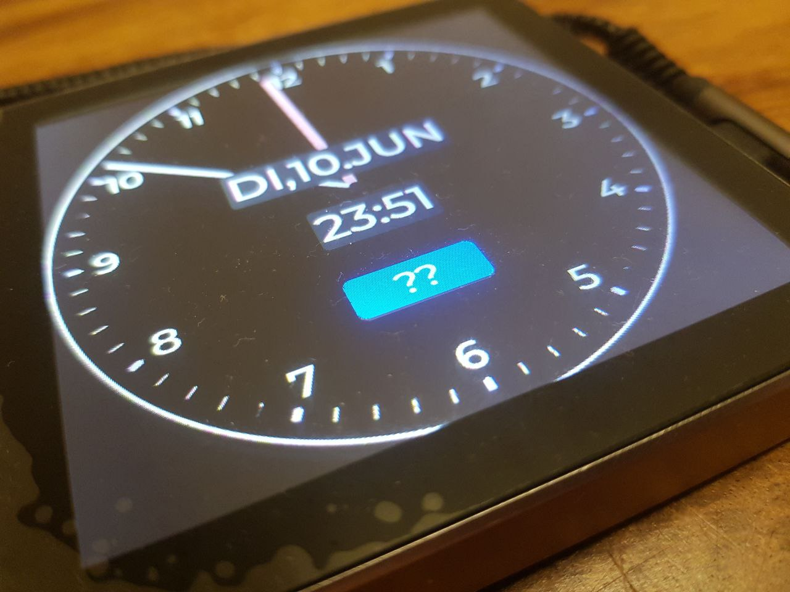
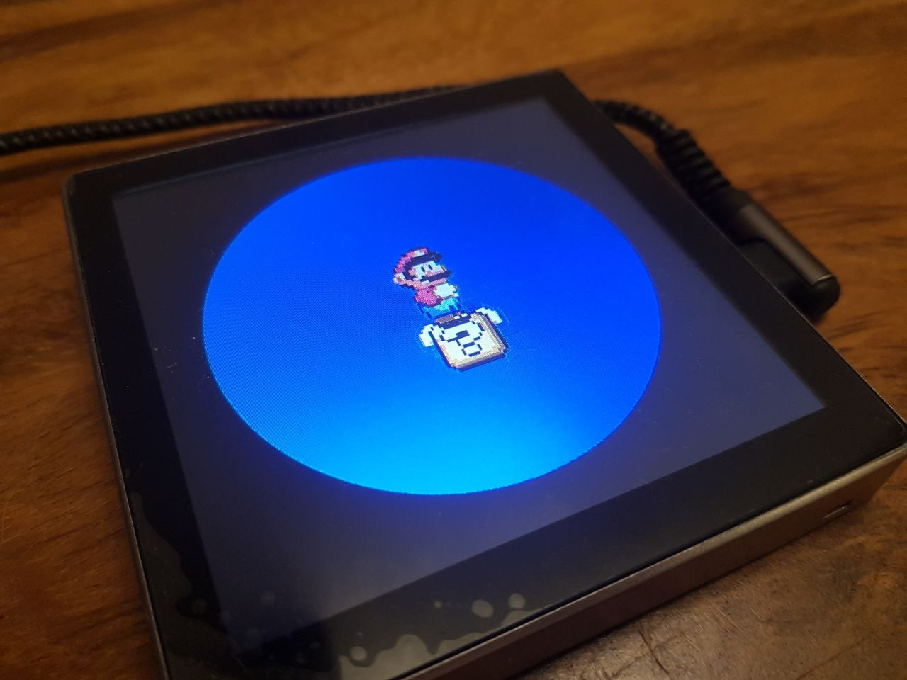

## Description

The "ESP32-S3 4.0 Inch Smart Display" is a cheap (~30 Euro) wall-mounted touch display

- ESP32-S3 (QFN56) with 16MB flash and 8MB PSRAM
- 4 inch display (driven with a ST7701s) and a GT911 touch screen
- 1 or 3 relays

## Links

- [Shop](https://www.aliexpress.com/item/1005006335587633.html)
- [Schematics, Datasheets and Examples](http://pan.jczn1688.com/directlink/1/ESP32%20module/4.0inch_ESP32-4848S040.zip)

## Simple Configuration

The example contains the device hardware settings. Add your Wi-Fi, API and OTA configuration separately.

```yaml file=config.yaml
```

## Advanced Configuration

- to be combined with the simple configuration above
- shows an analog clock and a button that triggers an animation



The photo shows the original animation. This example uses the bundled three-frame color animation from
[ESPHome's animation tests](https://github.com/esphome/esphome/blob/2026.10.2/tests/components/animation/anim.webp),
under the [MIT license](https://github.com/esphome/esphome/blob/2026.10.2/LICENSE).

```yaml file=advanced-configuration.yaml
```
