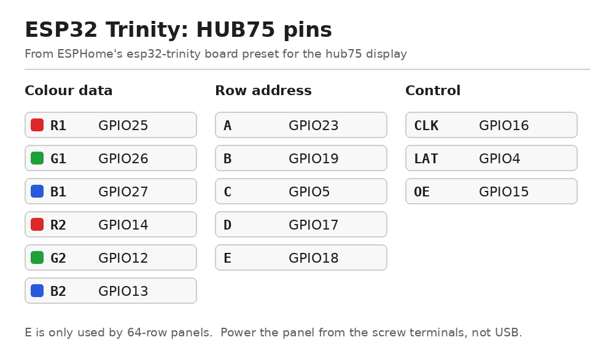

## Description

The [ESP32 Trinity](https://esp32trinity.com/) is an open-source ESP32 board built specifically for driving HUB75
RGB LED matrix panels. It is the work of Brian Lough (witnessmenow).

- ESP32-WROOM-32D module, with no PSRAM
- A HUB75 socket that plugs straight onto the panel's input header, so there is no ribbon cable or hand-wiring
- Screw terminals for 5&nbsp;V panel power, with the board able to run from the same supply
- Two capacitive touch pads (`GPIO32`, `GPIO33`) and an add-on header; microSD and Qwiic come on separate add-on boards
- USB-C for power and flashing

## Setup

1. Plug the Trinity straight onto the panel's input header. On most panels that is the connector the PCB arrows
   point away from, and the arrows on the Trinity should point the same way. If it doesn't fit, use the 2×8
   stacking header that comes with it.
2. Feed 5&nbsp;V into the screw terminals — a matrix panel draws far more current than USB can supply.
3. Create the device in the ESPHome Device Builder, which sets up Wi-Fi, `api:` and `ota:` for you. Merge in the
   hardware configuration below, set `panel_width` and `panel_height` to match your panel, and flash it.

## Configuration

The `hub75` display platform ships a **board preset for the Trinity**, so `board: esp32-trinity` supplies the
entire pinout and no pins need listing. The example below draws red, green and blue bars inside a white border.
It needs no network, so it is a quick proof that the panel is scanning correctly. The onboard LED on `GPIO2` is
exposed as a light.

```yaml file=config.yaml
```

For reference, the preset resolves to R1 `GPIO25`, G1 `GPIO26`, B1 `GPIO27`, R2 `GPIO14`, G2 `GPIO12`,
B2 `GPIO13`, A `GPIO23`, B `GPIO19`, C `GPIO5`, D `GPIO17`, E `GPIO18`, LAT `GPIO4`, OE `GPIO15`, CLK `GPIO16`.



### Clock

Once the board is on your Wi-Fi, add this to replace the test pattern with a clock from network time. Until the
time arrives it shows a dim `--:--`, so a dark panel still means a real fault.

```yaml file=clock.yaml
```

## Notes

- **Using the board preset removes the most common cause of a garbled panel.** Hand-wired HUB75 builds usually
  fail on the address lines: get C, D or E wrong and the panel renders in duplicated bands rather than showing
  nothing, which reads like a broken panel rather than a wiring fault. On a 64×64 panel the E line matters — a
  32-row panel does not use it, so a pinout copied from a 64×32 build will look like it works and then double
  every four rows.
- **Some panels need `shift_driver: FM6126A`.** Those panels stay dark or show badly wrong colours until the
  driver chip is initialised. If your panel does nothing with an otherwise correct configuration, that setting is
  the first thing to try.
- Power the panel from its screw terminals, not from the USB connector. A 64×64 panel at full white can pull
  several amps.
