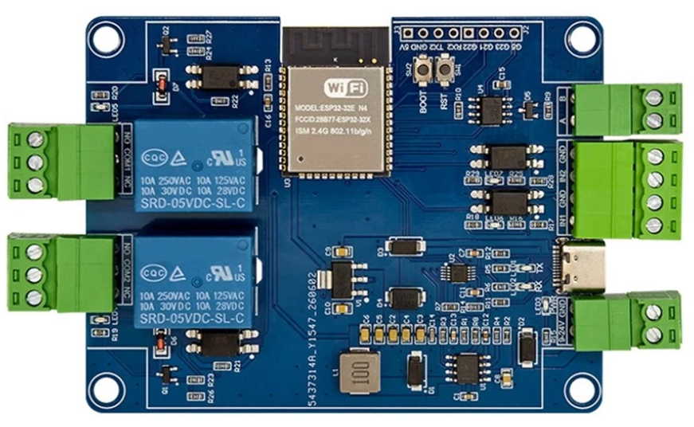
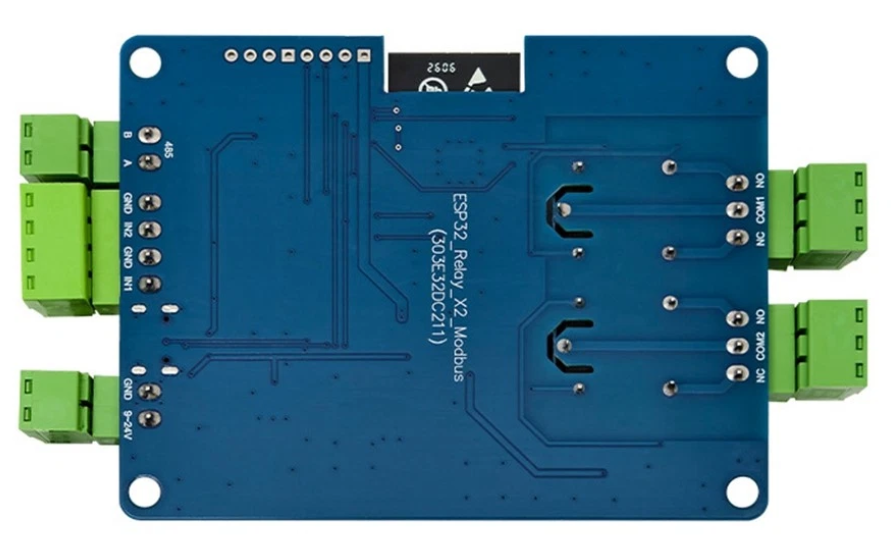

## Product description

This is a 2-relay board, having 2 binary inputs and an RS485 interface based on ESP32. The inputs are optoisolated (mine
came with TLP785GB with 4.7k resistors on inputs, making it safe to operate them around max 24V), with a common ground,
independent from the board's main gound. The RS485 transceiver is a SP3485E. Connectors are detacheable.

This appears to be a close relative to the ESP32_Relay_X4_Modbus_V1.3

I bought it from: [https://www.ebay.co.uk/itm/198658928427](https://www.ebay.co.uk/itm/198658928427)

## GPIO Pinout

| Pin    | Function  |
| ------ | --------- |
| GPIO33 | Relay 1   |
| GPIO25 | Relay 2   |
| GPIO27 | Input 1*  |
| GPIO26 | Input 2*  |
| GPIO19 | RS485 TX  |
| GPIO18 | RS485 RX  |
| GPIO32 | RS485 DE* |
| GPIO15 | LED       |
| GPIO16 | Pad RX2   |
| GPIO17 | Pad TX2   |
| GPIO5  | Pad G5    |
| GPIO21 | Pad G21   |
| GPIO22 | Pad G22   |
| GPIO23 | Pad G23   |

Footnote * - Pin TBC

All pins are inverted. It also exposes GPIOs 5, 21, 22, 23 labelled appropriately on the board.

## Basic Config

```yaml file=config.yaml
```
