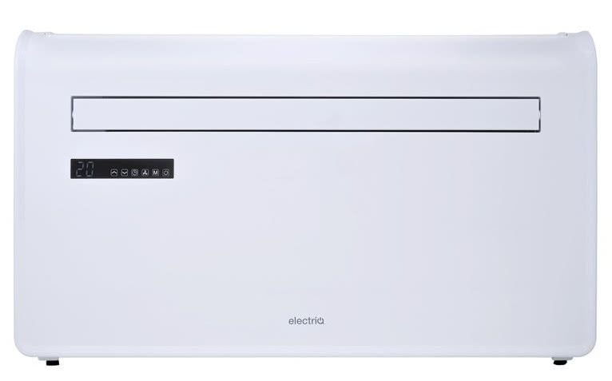

## Product Images



## GPIO Pinout

| Pin    | Function     |
| ------ | ------------ |
| GPIO13 | UART Tuya RX |
| GPIO15 | UART Tuya TX |

## Basic Configuration

```yaml
# Basic Config
substitutions:
  device_name: "electriqaircon"
  friendly_name: "Electriq air con"

esphome:
  name: "${device_name}"
  friendly_name: "${friendly_name}"
  on_boot:
    priority: 800
    then:
      - select.set:
          id: mode
          option: "Heating"
      - select.set:
          id: fanspeed
          option: "Medium"

esp8266:
  board: esp01_1m
    
# OTA flashing
ota:
  - platform: esphome

wifi: # Your Wifi network details
  
# Enable fallback hotspot in case wifi connection fails  
  ap:

# Enabling the logging component
logger:
  baud_rate: 0

# Enable Home Assistant API
api:

# Enable the captive portal
captive_portal:

# Enable the Web Server component 
webserver:

uart:
  rx_pin: GPIO13
  tx_pin: GPIO15
  baud_rate: 9600

# Register the Tuya MCU connection
tuya:
  on_datapoint_update:
    - sensor_datapoint: 3 # current temperature
      datapoint_type: int
      then:
        - lambda: |-
            ESP_LOGD("main", "current_temperature %d", x);

binary_sensor:
  - platform: status
    name: "${friendly_name} Status"

sensor:
  - platform: uptime
    name: "${friendly_name} Uptime"
  - platform: "tuya"
    name: "Current Temperature"
    sensor_datapoint: 3

climate:
  - platform: tuya
    name: "${friendly_name} Climate"
    supports_heat: True
    supports_cool: true
    switch_datapoint: 1
    target_temperature_datapoint: 2
    current_temperature_datapoint: 3

switch:
  - platform: "tuya"
    name: "${friendly_name} Sleep Mode"
    switch_datapoint: 101
  - platform: "tuya"
    name: "${friendly_name} Oscillating air paddle"
    switch_datapoint: 104

select:
  - platform: "tuya"
    name: "${friendly_name} Mode"
    id: mode
    enum_datapoint: 4
    optimistic: true
    options:
      0: Cooling
      1: Fan Only
      2: De-Humidify
      3: Heating
  - platform: "tuya"
    name: "${friendly_name} Fan Speed"
    id: fanspeed
    enum_datapoint: 5
    optimistic: true
    options:
      0: Low
      1: Medium
      2: High
  - platform: "tuya"
    name: "${friendly_name} Temperature Unit"
    id: temperatureunit
    enum_datapoint: 19
    optimistic: true
    options:
      0: C
      1: F
```
