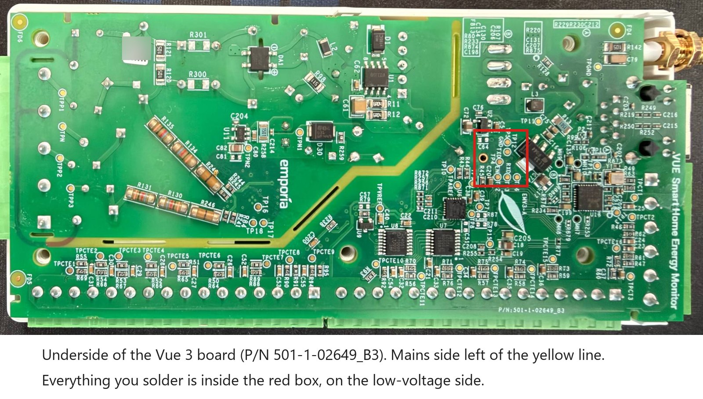
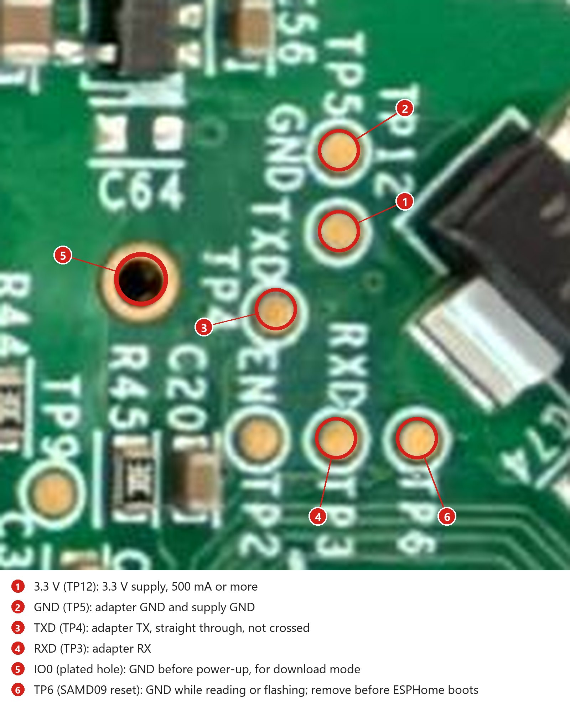

Emporia Vue Gen 3 (model EMV3A): a 16-circuit panel energy monitor, mains
powered (100-240 V). Inside are an ESP32-WROVER-IE with 8 MB flash and an
IPEX antenna lead, a SAMD09 that does the metering and talks to the ESP32 over
I2C, and an RTL8201F Ethernet PHY. Notes are from board P/N 501-1-02649_B3.

Metering uses the [rosenrot00/emporiavue](https://github.com/rosenrot00/emporiavue)
driver in I2C mode, which keeps the stock SAMD09 firmware.

## GPIO Pinout

| Pin                            | Function                                          |
| ------------------------------ | ------------------------------------------------- |
| GPIO5                          | I2C SDA (SAMD09 at 0x64)                          |
| GPIO18                         | I2C SCL                                           |
| GPIO13                         | SAMD09 SWDIO (TP8)                                |
| GPIO14                         | SAMD09 SWCLK (TP7)                                |
| GPIO23                         | SAMD09 reset (TP6)                                |
| GPIO2                          | Wi-Fi status LED                                  |
| GPIO4                          | Ethernet status LED                               |
| GPIO0                          | RMII 50 MHz clock in from the PHY (also IO0 boot) |
| GPIO32                         | Ethernet MDC                                      |
| GPIO33                         | Ethernet MDIO                                     |
| GPIO19, 21, 22, 25, 26, 27     | RMII data (fixed on the ESP32)                    |

## Flashing

Disconnect mains before opening the case, and never connect a serial adapter
while the Vue is on mains. The serial pads are on the underside of the board,
on the low-voltage side. Pogo pins or test clips are enough; no soldering is
needed to flash.





- The TXD/RXD labels are from the adapter's side: TXD to adapter TX, RXD to
  adapter RX.
- IO0 is the plated hole; tie it to GND before power-up.
- Tie TP6 (SAMD09 reset) to GND as well. With the SAMD09 running, serial reads
  had single flipped bits every 20-90 KB and the esptool stub didn't come up;
  with TP6 low, a full 8 MB read passed every block checksum.
- After flashing, power off and remove both the IO0 and the TP6 wires. With
  IO0 still grounded the ESP32 starts the ROM downloader again instead of
  ESPHome, and ESPHome drives TP6 from GPIO23.
- Power the 3.3 V pad (TP12) from a supply good for 500 mA. A USB-serial
  adapter's 3.3 V pin sagged under the board.

Back up the stock firmware first:

```bash
esptool --chip esp32 -p COM5 read-flash 0 ALL vue3-stock.bin
```

The image contains your Wi-Fi credentials and the unit's Emporia identity.

## Ethernet

Ethernet works with the settings in the config below and can sit next to
Wi-Fi: with `network: priority`, traffic uses the cable while it has a link.
GPIO0 carries the PHY's reference clock, so ESPHome warns about the strapping
pin; that is expected.

## Basic Configuration

The example assumes single-phase wiring: `vue3-1phase.yaml` measures the BLACK
voltage input with main clamp A, and every circuit uses line 1. For split-phase
or three-phase installations use the driver's `vue3-2phase.yaml` or
`vue3-3phase.yaml` and set each circuit's `line` to its actual voltage
reference.

The driver's default voltage calibration (0.022) read about 14 % high on the
first unit; calibrate against a meter. Add `power` to the circuits you use.
`energy` also needs a `time:` source (SNTP or Home Assistant), which this
hardware-only example leaves out.

The driver's optional `vue3-gpios.yaml` (status LEDs on GPIO2 and GPIO4) is left
out: at 2026.11.1 it lights only the Wi-Fi LED whenever Wi-Fi is compiled in,
so with Ethernet and Wi-Fi together the Ethernet LED stays off.

```yaml file=config.yaml
```

## Optional

[WattLedger](https://github.com/darek-margas/wattledger) adds on-device
journaling, direct PVOutput uploads and cost tracking. Its
[Vue 3 guide](https://github.com/darek-margas/wattledger/blob/main/docs/vue3-hardware.md)
covers fitting an RV-3028 RTC on the same I2C bus. That one does need
soldering: there is no I2C test point, so SDA and SCL go to WROVER pins 29
and 30.
