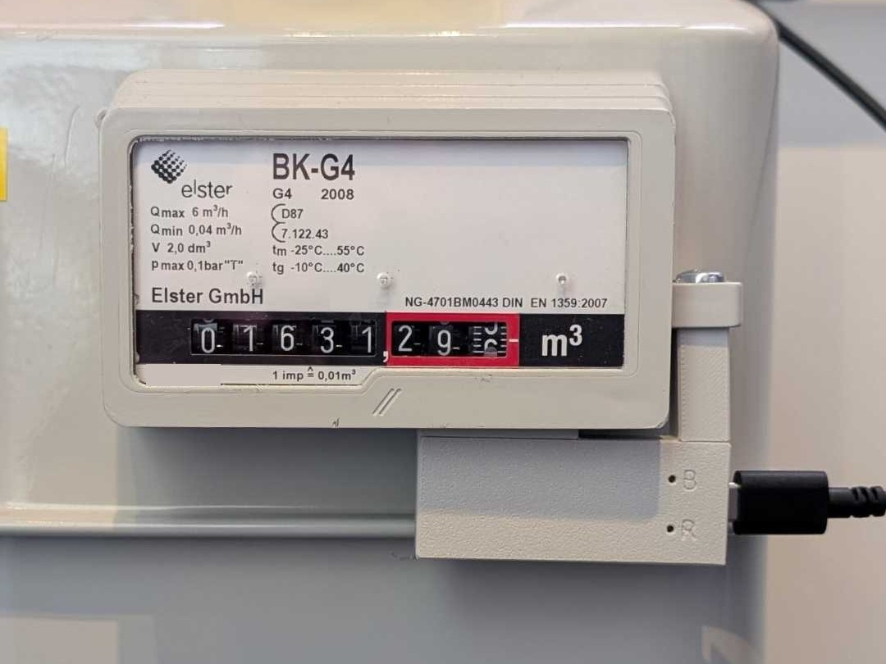

## Description

The Gas Connect for ESPHome by [NG3D-Druck](https://ng3d-druck.de) is a pulse sensor for gas meters with a reed
contact, with a built-in Waveshare ESP32-C3-Zero. It ships with ESPHome pre-installed and is available as
**Gas Connect BK for ESPHome**, which fits e.g. Elster/Honeywell BK-G2.5–G25.

Features:

- Gas meter reading for the Home Assistant energy dashboard, plus gas flow
- Consumption today, yesterday, this month and this year, rolling over at local midnight
  (timezone taken over from Home Assistant)
- Set the meter reading once to match the value shown on the meter
- Selectable volume per pulse (0.001 / 0.01 / 0.1 / 1 m³) and adjustable debounce time of the reed contact
- Status LED (no Wi-Fi, no Home Assistant connection, pulse detected); can show only the status or be turned off
- Firmware updates via Home Assistant

## Setup

1. Mount the sensor on the meter and power it via USB-C.
2. Connect it to Wi-Fi with Improv via Bluetooth (Home Assistant app), Improv via USB in the
   [web installer](https://ng3d-druck.github.io/Gas-Connect-for-ESPHome/), or the fallback hotspot.
3. Add it in Home Assistant, where it is discovered automatically. Set **Pulse volume** if your meter does not count
   0.01 m³ per revolution, then enter the current value of the meter in **Set meter reading**.

## GPIO Pinout

| Pin    | Function                       |
| ------ | ------------------------------ |
| GPIO4  | Reed contact (to GND, pull-up) |
| GPIO10 | Onboard WS2812 RGB LED         |

## Configuration

```yaml url=https://github.com/NG3D-Druck/Gas-Connect-for-ESPHome/blob/main/gas-connect.factory.yaml
```
