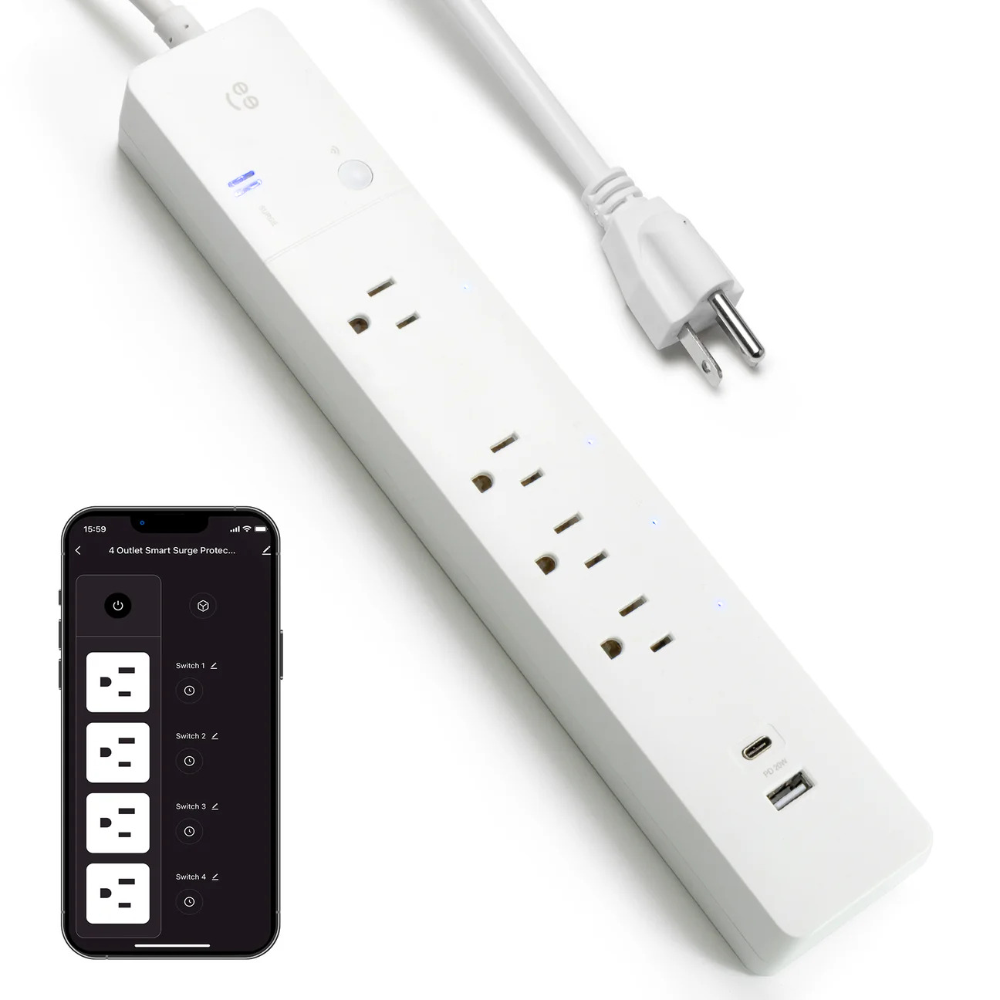
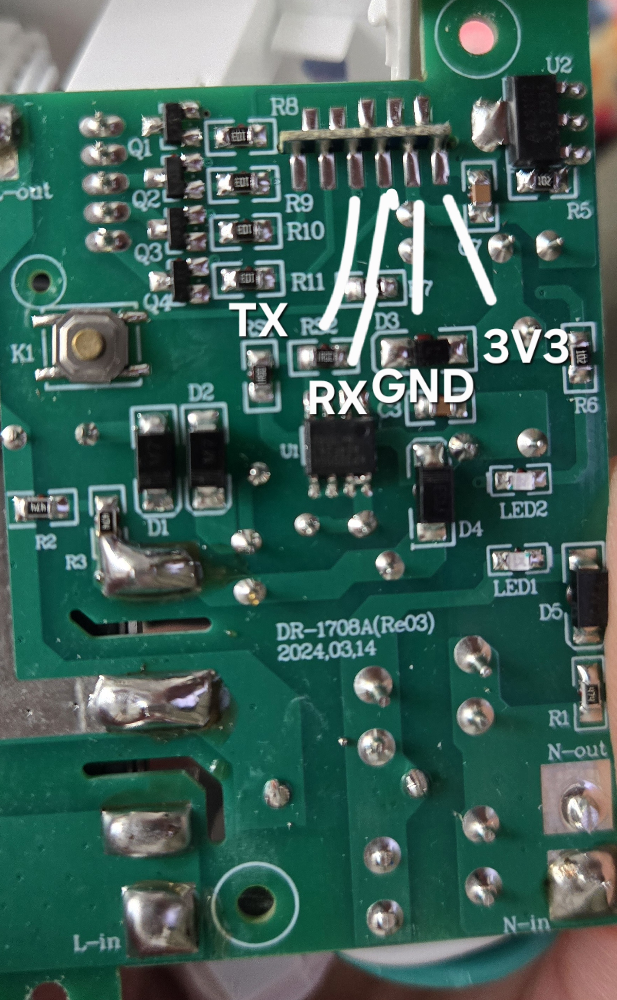

[Amazon Link](https://www.amazon.com/dp/B0D4R98V5F)

## Product Image



## General Notes

Manufacturer: [Geeni](https://mygeeni.com/)

MCU: [Tuya 2BSC](https://developer.tuya.com/en/docs/iot/cb2s-module-datasheet?id=Kafgfsa2aaypq)

The toggle switch shuts off everything. It can not be controlled or monitored by esphome.

The USB ports are controlled by the toggle switch only. They can not be controlled or monitored by esphome.

Each outlet's relay is rated at 15A.

## Access

You must disassemble the unit and solder on a serial flasher. See also the flashing guide in [https://docs.libretiny.eu/docs/platform/beken-72xx/](https://docs.libretiny.eu/docs/platform/beken-72xx/).

## GPIO Pinout

| Pin | Function                       |
| --- | ------------------------------ |
| P6  | Outlet 1 (nearest to the plug) |
| P7  | Outlet 2                       |
| P26 | Outlet 3                       |
| P24 | Outlet 4                       |
| P10 | Button  (inverted)             |
| P11 | Blue LED (inverted)            |

## Disassembly Guide

1. Remove all the back screws
2. Snap apart the halves
3. Remove 2 screws holding the PCB where the power cord attaches
4. Gently pull out the copper strips for the neutral and groun pins of the outlets
5. Pull out the PCB and flip it over
6. Solder your serial adaptor wires to the GND, VCC, RX and TX pads.


## Configuration

Add your own Wi-Fi credentials, API and OTA settings to this hardware configuration.

```yaml file=config.yaml
```

### Home Assistant time

Merge this optional fragment with `config.yaml` to retain the Home Assistant time source. It requires the API
component in your own configuration.

```yaml file=home-assistant-time.yaml
```
