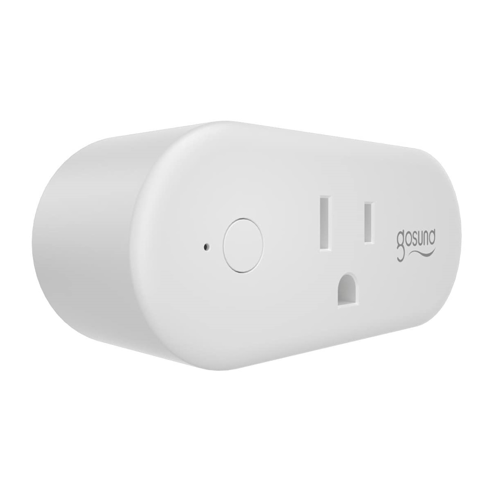

## GPIO Pinout

| Pin    | Function             |
| ------ | -------------------- |
| GPIO03 | Push Button inverted |
| GPIO13 | Red LED (Status LED) |
| GPIO01 | Blue LED (Led1i)     |
| GPIO14 | Relay 1              |

## Basic Configuration

```yaml
substitutions:
  device_name: gosund_wp6
  friendly_name: Gosund WP6

esphome:
  name: "${device_name}"

esp8266:
  board: esp01_1m

# OTA flashing
ota:
  - platform: esphome

wifi: # Your Wifi network details
  
# Enable fallback hotspot in case wifi connection fails  
  ap:

# Enabling the logging component
logger:

# Enable Home Assistant API
api:

# Enable the captive portal
captive_portal:

binary_sensor:
  - platform: gpio
    pin:
      number: GPIO03
      mode: INPUT_PULLUP
      inverted: True
    name: "${friendly_name} Button"
    id: "${device_name}_button"
    on_press:
      - switch.toggle: "${device_name}_relay"
  - platform: status
    name: "${friendly_name} Status"
    id: "${device_name}_status"

switch:
  - platform: gpio
    name: "${friendly_name} Relay"
    id: "${device_name}_relay"
    pin: GPIO14
    on_turn_on:
      - output.turn_on: led
    on_turn_off:
      - output.turn_off: led

status_led:
  pin:
    number: GPIO13

output:
  - platform: gpio
    pin: GPIO01
    inverted: true
    id: led

```
