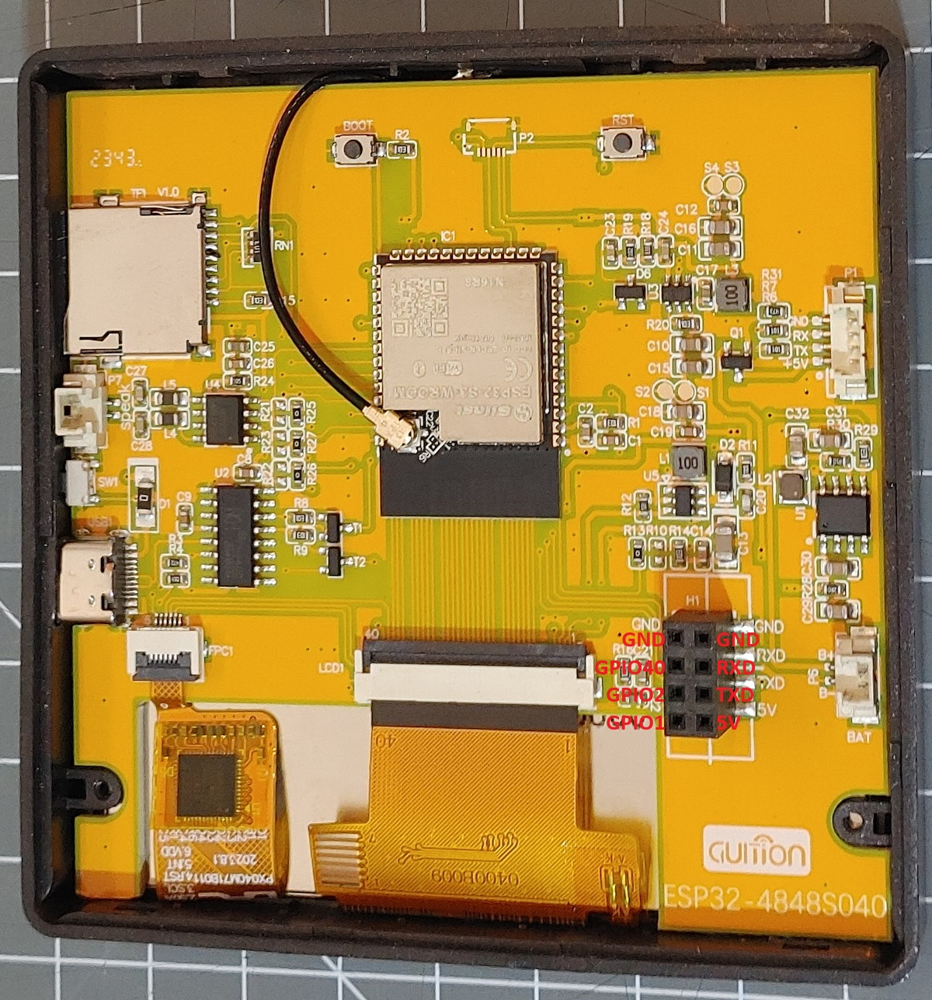

## Product specs

| Feature      | Spec                    |
| ------------ | ----------------------- |
| Screen       | st7701s driver 480\*480 |
| Touch screen | gt911                   |
| CPU          | ESP32-S3                |
| Flash        | 16MB                    |
| PSRAM        | 8MB                     |

## Product description

Avalible on [AliExpress](https://www.aliexpress.com/item/3256806115962222.html) at various vendors. Can be purchased
with or without the relay module, which does not fit into a standard EU round 60mm box.

The device can also be powered through the black connector on the back. This connector does not provide reverse-polarity protection. **Check the polarity carefully before connecting power:** reversing 5 V and GND will permanently damage the device.




## Basic Config

```yaml
esphome:
  name: "guition-esp32-s3-4848s040"
  friendly_name: "4848s040"

esp32:
  variant: esp32s3
  framework:
    type: esp-idf

psram:
  mode: octal
  speed: 80MHz

logger:

api:
  encryption:
    key: !secret encryption_key

ota:
  - platform: esphome
    password: !secret ota_password
    on_begin: # prevent screen flickering during OTA
      - light.turn_off:
          id: display_backlight
          transition_length: 0s
      - lambda: "id(display_backlight).loop();"

wifi:
  ssid: !secret wifi_ssid
  password: !secret wifi_password

switch:
  - platform: gpio
    name: Relay 1
    pin:
      number: GPIO40
      inverted: true
  - platform: gpio
    name: Relay 2
    pin:
      number: GPIO2
      inverted: true
  - platform: gpio
    name: Relay 3
    pin:
      number: GPIO1
      inverted: true

output:
  - platform: ledc
    id: backlight_output
    pin: GPIO38
    frequency: 150Hz
    min_power: 0.01
    zero_means_zero: true

light:
  - platform: monochromatic
    name: Backlight
    id: display_backlight
    output: backlight_output
    restore_mode: ALWAYS_ON
    default_transition_length: 1s

spi:
  - id: lcd_spi
    clk_pin: GPIO48
    mosi_pin: GPIO47

i2c:
  id: touchscreen_bus
  sda: GPIO19
  scl:
    number: 45
    ignore_strapping_warning: true

display:
  - platform: st7701s
    id: tft_display
    dimensions:
      width: 480
      height: 480
    #    rotation: 270    #uncomment for placement with down-facing USB socket
    spi_mode: MODE3
    data_rate: 2MHz
    color_order: RGB
    invert_colors: False
    cs_pin: 39
    de_pin: 18
    hsync_pin: 16
    vsync_pin: 17
    pclk_pin: 21
    pclk_frequency: 12MHz
    pclk_inverted: False
    hsync_pulse_width: 8
    hsync_front_porch: 10
    hsync_back_porch: 20
    vsync_pulse_width: 8
    vsync_front_porch: 10
    vsync_back_porch: 10
    update_interval: never
    auto_clear_enabled: False
    init_sequence:
      - 1
      - [0xFF, 0x77, 0x01, 0x00, 0x00, 0x10] # CMD2_BKSEL_BK0
      - [0xCD, 0x00] # disable MDT flag
    data_pins:
      red: [11, 12, 13, 14, 0]
      green: [8, 20, 3, 46, 9, 10]
      blue: [4, 5, 6, 7, 15]

touchscreen:
  - platform: gt911
    id: tft_touch
    display: tft_display
#    transform:     #uncomment for placement with down-facing USB socket
#      swap_xy: true
#      mirror_x: true
```


## Enabling the speaker

The display includes an NS4168 I²S class-D amplifier, but enabling it requires a hardware modification. The I²S signals are not connected to the ESP32-S3 pins by default.

With the device disconnected from power, move the 0-ohm resistors R25, R26, and R27 to the R21, R22, and R23 positions, respectively. This connects the amplifier's I²S inputs to GPIO1, GPIO2, and GPIO40. The modification disconnects those GPIOs from relays L1, L2, and L3, so those relays can no longer be used.


To enable audio in ESPHome, remove the relay `switch:` entries for GPIO1, GPIO2, and GPIO40 from the basic configuration, then add:

```yaml
i2s_audio:
  - id: audio_bus
    i2s_bclk_pin: GPIO1
    i2s_lrclk_pin: GPIO2

speaker:
  - platform: i2s_audio
    id: output_speaker
    i2s_audio_id: audio_bus
    dac_type: external
    i2s_dout_pin: GPIO40
    channel: mono
    sample_rate: 48000
    bits_per_sample: 16bit

  - platform: mixer
    id: audio_mixer
    output_speaker: output_speaker
    source_speakers:
      - id: announcement_mixer_input
      - id: media_mixer_input

  - platform: resampler
    id: announcement_speaker
    output_speaker: announcement_mixer_input
    sample_rate: 48000
    bits_per_sample: 16

  - platform: resampler
    id: media_speaker
    output_speaker: media_mixer_input
    sample_rate: 48000
    bits_per_sample: 16

media_player:
  - platform: speaker
    id: smart_screen_player
    name: Media Player
    announcement_pipeline:
      speaker: announcement_speaker
      format: FLAC
      sample_rate: 48000
      num_channels: 1
    media_pipeline:
      speaker: media_speaker
      format: FLAC
      sample_rate: 48000
      num_channels: 1
```
lvgl:
```
