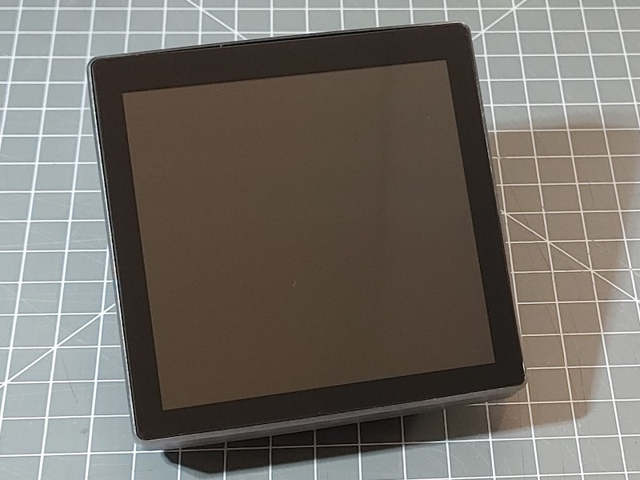

## Product specs

| Feature      | Spec                    |
| ------------ | ----------------------- |
| Screen       | st7701s driver 480\*480 |
| Touch screen | gt911                   |
| CPU          | ESP32-S3                |
| Flash        | 16MB                    |
| PSRAM        | 8MB                     |

## Product description

Available on [AliExpress](https://www.aliexpress.com/item/3256806115962222.html) at various vendors. It can be purchased
with or without the relay module, which does not fit into a standard EU round 60mm box.

The device can also be powered through the black connector on the back. This connector does not provide
reverse-polarity protection. **Check the polarity carefully before connecting power:** reversing 5 V and GND
can permanently damage the device.


## Basic configuration

This hardware configuration includes the display, touchscreen, and backlight. Add either the relay or speaker
configuration below, as appropriate for your device.

```yaml file=config.yaml
```

## Relay configuration

The relay outputs use GPIO40, GPIO2, and GPIO1. Do not combine this configuration with the speaker
configuration below.

```yaml file=relays.yaml
```

## Enabling the speaker

The display includes an NS4168 I²S class-D amplifier, but enabling it requires a hardware modification.
The I²S signals are not connected to the ESP32-S3 pins by default.

With the device disconnected from power, move the 0-ohm resistors R25, R26, and R27 to the R21, R22,
and R23 positions, respectively. This connects the amplifier's I²S inputs to GPIO1, GPIO2, and GPIO40.
The modification disconnects those GPIOs from relays L1, L2, and L3, so those relays can no longer be used.

See the [hardware description and photos](https://michiel.vanderwulp.be/domotica/Modules/SmartDisplay-ESP32-S3-4.0inch/)
for details. Component positions may vary between board revisions; check the markings and photos for your
board before soldering. If you are unfamiliar with surface-mount soldering, ask someone experienced to do
the modification.

After the hardware modification, use this speaker configuration instead of the relay configuration:

```yaml file=speaker.yaml
```
