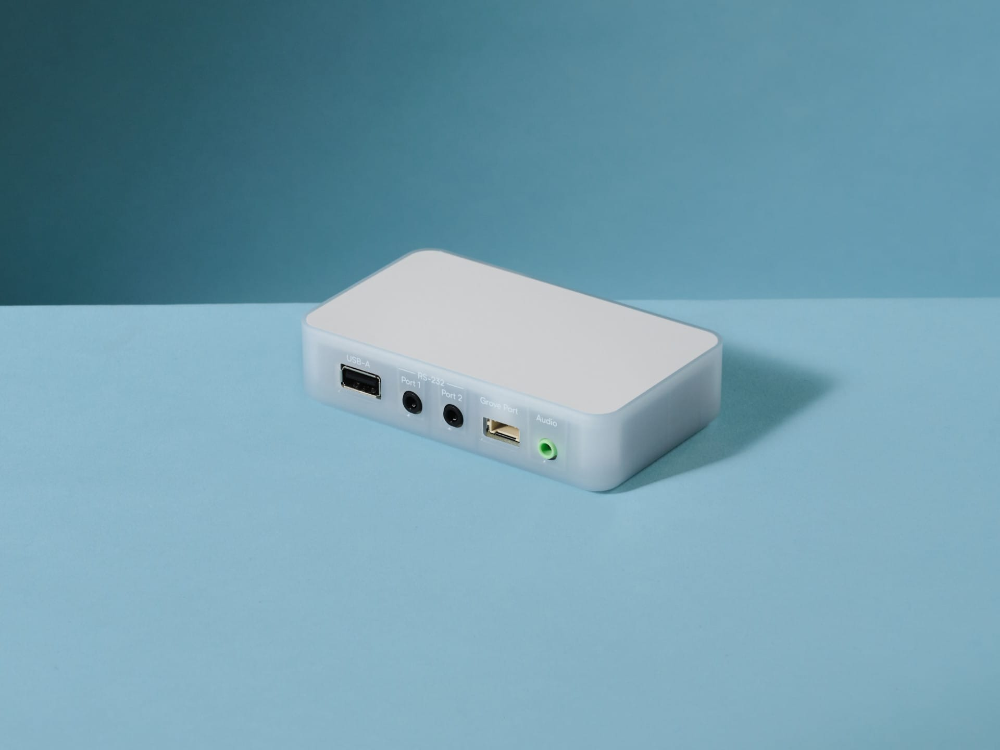

## Description



The Home Assistant Connect AUX-2 by Nabu Casa connects serial, USB and audio devices to Home Assistant over
Ethernet or Wi-Fi. It ships with ESPHome and can be set up with Improv over Bluetooth or USB. See the
[product page](https://www.nabucasa.com/hardware/aux-2/) for more details.

To re-install the factory firmware, use the [web installer](https://firmware.nabucasa.com/install/aux-2/).

## Features

- ESP32-S3 with 8 MB flash and PSRAM
- Supports Ethernet (W5500, with PoE) and Wi-Fi connections
- Two RS-232 ports, exposed to Home Assistant as serial proxies
- USB host port for:
  - Home Assistant Connect ZWA-2 (Z-Wave proxy)
  - Home Assistant Connect ZBT-2 (Zigbee serial proxy)
  - CH343-based USB serial adapters, such as RS-485 dongles (serial proxy)
- Media player with Sendspin support, through a 3.5 mm combo jack: analog line out (PCM5122 DAC) or optical
  S/PDIF, selected automatically
- Bluetooth proxy
- Grove port with switchable power
- Status light (RGB LED) and a button for factory reset

## Grove port

The Grove port is an I²C bus (`i2c_grove`, 400 kHz) at 5 V logic levels: SDA and SCL pass through a level
shifter with 5.1 kΩ pull-ups to the port's 5 V supply. The 5 V supply is switched by GPIO46 (high = on), exposed
as the "Grove Power" switch. It defaults to on and restores its previous state after reboot. Its entity is
disabled by default in Home Assistant.

The port is intended primarily for I²C, but GPIO1 and GPIO2 can be used for other purposes, such as digital
inputs and outputs. To free the pins, remove the bus by adding `- id: !remove i2c_grove` under `i2c:` in your
configuration. Both lines still pass through the level shifter and idle high at 5 V through the pull-ups.

| Grove pin | Signal        | ESP32-S3          |
| --------- | ------------- | ----------------- |
| 1         | SCL           | GPIO2             |
| 2         | SDA           | GPIO1             |
| 3         | 5 V, switched | enabled by GPIO46 |
| 4         | GND           |                   |

## Firmware updates

The factory firmware updates through the `update` entity in Home Assistant. Updates are signed, and the device
verifies the signature before installing them.

The factory firmware has no network OTA endpoint. After you take control of the device in the ESPHome Device
Builder, install the first build over USB-C. That build includes `ota: - platform: esphome` from
`packages/aux-2.yaml`, so later builds can be installed over the network.

Flashing over USB needs no keys and no disassembly: hardware Secure Boot and flash encryption are not enabled, so
the device always accepts new firmware over USB.

## Configuration

The factory configuration:

```yaml url=https://github.com/NabuCasa/aux-2/blob/main/connect-aux-2.yaml
```

The core configuration, imported when you take control of the device:

```yaml url=https://github.com/NabuCasa/aux-2/blob/main/packages/aux-2.yaml
```
