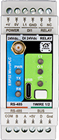
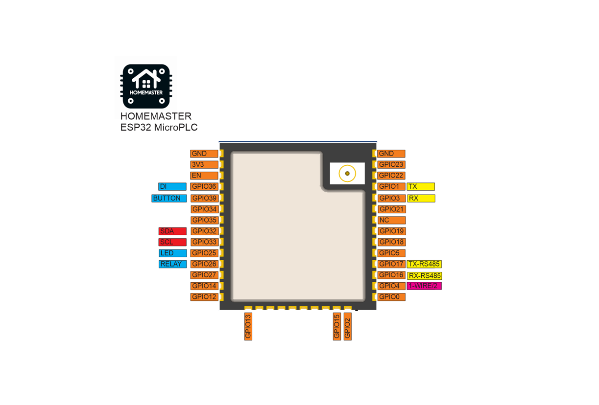
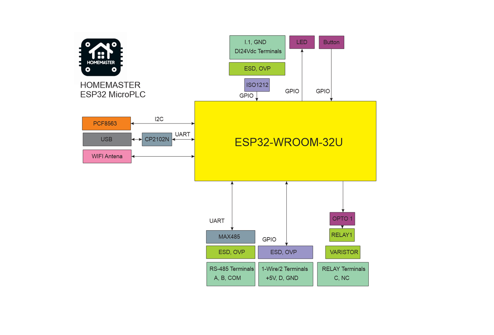

## HomeMaster MicroPLC



## Description

The HomeMaster MicroPLC is a DIN-rail automation controller built on the
ESP32-WROOM-32U-N16. It ships with ESPHome installed and runs from a 24 V DC
field supply. On board: one relay channel, one isolated 24 V digital input, a
1-Wire bus, an RS-485 Modbus RTU port for HomeMaster expansion modules, and a
PCF8563 real-time clock that keeps the hour when the network is down.

This page links the full ESPHome configuration used on shipped devices,
including the vendor OTA update settings.

For complete product documentation (connections, compliance, wiring and
schematics), see:

- Product page: [home-master.eu shop](https://www.home-master.eu/shop/esp32-microplc-56)
- Repository: [GitHub repository](https://github.com/isystemsautomation/homemaster-dev/tree/site/MicroPLC)
- Datasheet (PDF):
  [MicroPLC_Datasheet.pdf](https://config.home-master.eu/MicroPLC/Manuals/MicroPLC_Datasheet.pdf)
- Schematics (PDF):
  - MCU Board:
    [MCUBoard.pdf](https://config.home-master.eu/MicroPLC/Schematics/MCUBoard.pdf)
  - Relay Board:
    [RelayBoard.pdf](https://config.home-master.eu/MicroPLC/Schematics/RelayBoard.pdf)

- Maker: [home-master.eu](https://www.home-master.eu/)

## Hardware Details

- **MCU:** ESP32-WROOM-32U-N16 (16 MB flash)
- **Architecture:** Modular — MCU Board + Relay Board
- **Part number:** HM-MICROPLC
- **Manufacturer:** ISYSTEMS AUTOMATION S.R.L.
- **Mounting:** 35 mm DIN rail, 2 modules

## Power Input

| Method | Terminals | Range |
| --- | --- | --- |
| 24 V DC | +V / 0V | 24 V DC nominal |
| USB-C | — | 5 V, for programming only |

The field supply is 24 V DC only. There is no mains input and no mains terminal
on the module.

## Peripherals

| Device | Interface | Address / pins |
| --- | --- | --- |
| PCF8563 real-time clock | I²C | 0x51 |
| I²C bus | I²C | SDA 32, SCL 33 |
| RS-485 transceiver, MAX485 | UART | TX 17, RX 16, 19200 baud |
| 1-Wire bus | GPIO | 4 |
| Relay, C / NC | GPIO | 26 |
| Digital input, isolated 24 V | GPIO | 36 |
| Front-panel button | GPIO | 39, active low |
| Status LED | GPIO | 25, inverted |

The RS-485 port is half-duplex Modbus RTU and is not galvanically isolated.
Terminate with 120 Ω at the two physical ends of the bus only. The `1WIRE 1/2`
legend on the case labels the two data terminals of a single bus, not two buses.

## Relay

> ⚠️ The relay channel is **C and NC only** (SPST-NC). The contact is closed —
> the load powered — whenever the module is unpowered or the switch is off.
> Module limit **3 A @ 250 V AC**. The contact is not internally fused; add
> external overcurrent protection. For a load that must stay off without power,
> use a module with a normally-open contact.

## Features

- ESP32-WROOM-32U-N16, Wi-Fi and Bluetooth LE
- ESPHome pre-installed, no cloud account and no vendor service in the path
- RS-485 Modbus RTU for HomeMaster expansion modules
- One relay channel, C / NC, opto-isolated drive with a varistor
- One isolated 24 V digital input, ISO1212, PTC fused, TVS protected
- Front-panel push button, exposed as a binary sensor
- 1-Wire bus with ESD and overvoltage protection
- PCF8563 real-time clock
- USB Type-C for programming and serial provisioning
- Improv provisioning over BLE and USB serial
- OTA updates (ESPHome + HTTP)
- DIN-rail mounting, 2 modules

## Pinout



## Functional Block Diagram



## Bus Configuration

### I²C

|     | PIN    |
| --- | ------ |
| SDA | GPIO32 |
| SCL | GPIO33 |

### I²C addresses

|         | address |
| ------- | ------- |
| pcf8563 | 0x51    |

## Mechanical and Environmental

| Dimension | Value |
| --- | --- |
| Size | 35.5 × 90.6 × 67.3 mm (L × W × H) |
| DIN width | 2 modules |
| Net weight | 120 g |

- Indoor use, inside a cabinet
- Ingress protection: IP20
- Operating temperature: 0 … +40 °C, 0–90 % RH, non-condensing
- Terminals: pluggable screw blocks, 5.08 mm pitch, 0.2–2.5 mm² (AWG 24–12)

## Compliance

CE marked. Complies with:

- EMC Directive 2014/30/EU — EN 55032 (Class B emissions), EN 55035 (immunity)
- Low Voltage Directive 2014/35/EU — EN 62368-1
- RoHS Directive 2011/65/EU — EN IEC 63000

The signed EU Declaration of Conformity and the UK PSTI statement are published
with the other documents.

## Getting Started

### Improv Wi-Fi Setup (Recommended)

1. Power the device.
2. Open [improv-wifi.com](https://improv-wifi.com) in Chrome or Edge.
3. Connect over Bluetooth, or over USB serial with a USB-C cable, and enter the
   Wi-Fi credentials.

The provisioning window stays open for 15 minutes after power-on. If it has
closed, power-cycle the module to open it again.

### Taking control

Do this inside the same 15-minute window. Open ESPHome Device Builder and click
**Take control**. This imports the configuration and establishes your own API
encryption key. Save that key before adding the device in Home Assistant.

If the window has already closed — easy to miss in a cabinet, where the module
may sit powered for an hour before anyone opens a laptop — power the module off
and on again. The window reopens for another 15 minutes.

## Firmware Updates

### ESPHome updates (user-controlled)

Adopt the device in ESPHome Device Builder and build from the published
configuration.

### Managed updates (HTTP)

The shipped configuration carries an `update` entity backed by a vendor JSON
manifest. New releases appear under Settings → Updates in Home Assistant.

## ESPHome Compatibility

Requires ESPHome 2026.7.0 or newer.

## Example Entities

| Entity | Type |
| --- | --- |
| ESP Status | binary_sensor (diagnostic) |
| DI #1 | binary_sensor |
| Button | binary_sensor |
| 1-Wire Bus 1 Temperature | sensor |
| WiFi Signal, ESP32 Temperature | sensor (diagnostic) |
| Relay | switch |
| ESP Uptime Human, ESPHome Version, ESP IP Address | text_sensor (diagnostic) |
| Firmware Update | update |

The RS-485 bus is exposed as the UART `uart_modbus`. Add your own
`modbus_controller:` blocks to it after taking control, to integrate HomeMaster
expansion modules or any other Modbus RTU device.

## Configuration

```yaml url=https://github.com/isystemsautomation/homemaster-dev/blob/main/MicroPLC/Firmware/microplc.yaml
```

## License

Hardware is licensed under CERN-OHL-W v2. Firmware and ESPHome configuration are
licensed under the MIT License.
