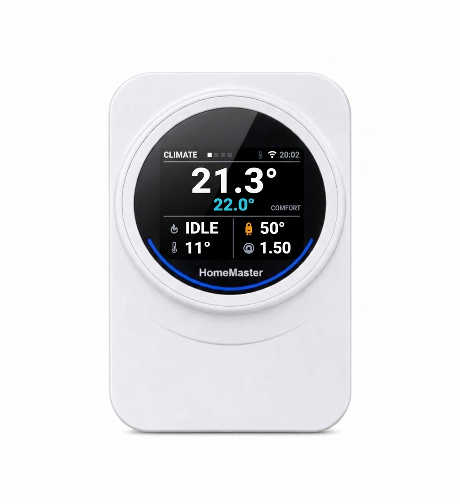

## HomeMaster Thermostat for OpenTherm



## Description

The HomeMaster Thermostat for OpenTherm is a wall-mounted ESP32 device that acts as an
**OpenTherm master** for modulating boilers. It carries a 2.8″ colour display, a
rotary encoder, four keys, a 24 GHz presence radar, and on-board temperature,
humidity and ambient light sensors.

The heating control loop runs on the device: weather-compensated flow temperature,
room setpoint with hysteresis, and a comfort/eco schedule. Home Assistant is used
for visibility and remote control, not as a dependency — the room keeps being
heated if the network is down.

This page includes the full ESPHome configuration used on shipped devices
(including vendor OTA update settings).

For complete product documentation (connections, compliance, wiring and
schematics), see:

- Product page: [home-master.eu shop](https://www.home-master.eu/shop/opentherm-thermostat-1514)
- Repository: [GitHub repository](https://github.com/isystemsautomation/homemaster-dev/tree/site/OpenthermThermostat)
- Datasheet (PDF):
  [OpenThermThermostat_Datasheet.pdf](https://config.home-master.eu/OpenthermThermostat/Manuals/OpenThermThermostat_Datasheet.pdf)
- User Manual (PDF):
  [OpenThermThermostat_UserManual.pdf](https://config.home-master.eu/OpenthermThermostat/Manuals/OpenThermThermostat_UserManual.pdf)
- Schematics (PDF):
  - MCU Board:
    [MCUBoard.pdf](https://config.home-master.eu/OpenthermThermostat/Schematics/MCUBoard.pdf)
  - Display Board:
    [LCDBoard.pdf](https://config.home-master.eu/OpenthermThermostat/Schematics/LCDBoard.pdf)

- Maker: [home-master.eu](https://www.home-master.eu/)

## Hardware Details

- **MCU:** ESP32-WROOM-32U (16 MB flash, U.FL antenna fitted inside the enclosure)
- **Architecture:** Modular — MCU Board + Display Board
- **Part number:** OTT-R1
- **Manufacturer:** ISYSTEMS AUTOMATION S.R.L.
- **Enclosure:** Italtronic EYE BOX, wall mounted

## Power Input

| Method | Terminals | Range |
|---|---|---|
| 24 V DC | +V / 0V | 24 V DC nominal |

The device is low-voltage only. No mains terminals are present.

**A mains power supply is not included.** The 24 V DC supply is provided by
the installer: a DIN-rail unit in the distribution board or the boiler
cabinet, or a module rated for installation inside a deep flush box. The
device draws 50–100 mA and never more than 2.4 W.

## Terminal Connections

| Terminal | Function |
|---|---|
| +V | 24 V DC supply |
| 0V | 0 V |
| OT+ | OpenTherm bus, boiler terminal 1 |
| OT− | OpenTherm bus, boiler terminal 2 |

The OpenTherm interface is polarity-insensitive.

## Peripherals

| Device | Interface | Address / pins |
|---|---|---|
| ST7789V display, 320 × 240 | SPI | CS 17, DC 19, RST 13, CLK 5, MOSI 23 |
| Backlight | LEDC PWM, 25 kHz | GPIO25 |
| SHT40 temperature / humidity | I²C | 0x44 |
| BH1750 ambient light | I²C | 0x23 |
| HLK-LD2410C presence radar | UART + GPIO | TX 14, RX 16, OUT 4 |
| Rotary encoder | GPIO | A 32, B 33 |
| Keys ▶ ▲ ▼ ◀ | GPIO | 34, 35, 36, 39 |
| OpenTherm | GPIO | IN 21, OUT 26 |

## GPIO Notes

### GPIO5 — display clock (strapping pin)

GPIO5 is a strapping pin on the ESP32. It is used here as the SPI clock for the
display and is driven only after boot. No external pull resistor is fitted.

### GPIO34 / 35 / 36 / 39 — keys

These are input-only pins with no internal pull resistors. Each key has an
external 10 kΩ pull-up to 3V3 and a 100 nF debounce capacitor on the board.

## Features

- ESP32 OpenTherm master — full boiler telemetry and modulating control
- Local control loop; no cloud and no Home Assistant dependency for heating
- 2.8″ IPS colour display, rotary encoder, four keys
- 24 GHz presence radar for screen wake and occupancy reporting
- On-board temperature, humidity and ambient light sensing
- ESPHome pre-installed
- Improv provisioning over BLE and USB serial
- OTA updates (ESPHome + HTTP)
- Wall mounting

## Electrical and Safety Notes

> ⚠️ Supplied from 24 V DC only. Do not connect mains voltage to any terminal.
> Disconnect power before wiring changes. Keep the OpenTherm pair out of mains
> cable bundles.

## Mechanical and Environmental

Enclosure: Italtronic EYE BOX, ABS, white (RAL 9003).

| Dimension | Value |
|---|---|
| Body outer diameter | Ø 94.6 mm |
| Front aperture | Ø 82.2 mm |
| Ring height | 20.5 mm |
| Wall base | Ø 88.7 mm, 10.5 mm deep, keyhole centres 58 mm |
| Wall plate (alternative) | 140 × 80 mm, 9 mm thick, cable aperture 45 × 30 mm |
| Plate fixing centres | 60 mm and 83.5 mm |

- Indoor use, dry locations
- Operating temperature: 0 … 40 °C, non-condensing
- Two-part enclosure: wall base or plate fixed to the wall, body clipped on

**Mounting.** The round base takes two screws straight into the wall at
58 mm centres. The rectangular plate screws onto a flush-mounting box and is
drilled for both common spacings: **60 mm**, the round European device box
with a Ø 68 mm bore, and **83.5 mm**, the Italian three-module box (503).
What decides whether a box fits is the distance between its device screws,
not the shape of the box.

## Getting Started

### Improv Wi-Fi Setup (Recommended)

1. Power the device.
2. Open [improv-wifi.com](https://improv-wifi.com) in Chrome or Edge.
3. Connect over Bluetooth, or over USB serial with a USB-C cable, and enter the
   Wi-Fi credentials.

The provisioning window stays open for 15 minutes after power-on. If it has
closed, power-cycle the thermostat to open it again.

### Taking control

Do this inside the same 15-minute window. Open ESPHome Device Builder and click
**Take control**. This imports the configuration and establishes your own API
encryption key. Save that key before adding the device in Home Assistant.

If the window has already closed — easy to miss during an installation, where
the thermostat may sit powered for an hour before anyone opens a laptop — power
off the thermostat and power it on again. The window reopens for another
15 minutes.

## Firmware Updates

### ESPHome updates (user-controlled)

Adopt the device in ESPHome Device Builder and build from the published
configuration.

### Managed updates (HTTP)

The shipped configuration carries an `update` entity backed by a vendor JSON
manifest. New releases appear under Settings → Updates in Home Assistant.

## ESPHome Compatibility

Requires ESPHome 2026.10.0 or newer, for the `improv_ble` component. The
`mipi_spi` display platform and the `opentherm` component have been available
since 2026.7.0.

## User Interface

Four keys and one encoder, identical on every page:

| Control | Action |
|---|---|
| ◀ ▶ | previous / next page |
| ▲ ▼ | open the menu, move through it |
| encoder | change the page's main value, or the selected menu item |
| ◀ with the menu open | close the menu |

Pages: CLIMATE (room, setpoint, boiler), BOILER (flow, return, DHW, faults),
SCHEDULE (comfort and eco windows), SYSTEM (network, sensors, diagnostics).

## Example Entities

| Entity | Type |
|---|---|
| Room Temperature, Room Humidity, Ambient Light | sensor |
| Heating Target, Flow Setpoint By Curve, Outside Temperature In Use | sensor |
| Boiler Water Temperature, Relative Modulation Level, CH Pressure | sensor |
| Boiler Flame On, CH Active, DHW Active, Fault Indication | binary_sensor |
| Comfort Window, Heat Demand, Presence, Radar Target | binary_sensor |
| Comfort Temperature, Eco Temperature | number |
| Boost Offset, Room Hysteresis, Room Sensor Offset | number (config) |
| Curve Cold/Warm Outside, Curve Cold/Warm Flow, Fixed Flow Setpoint | number (config) |
| Boiler CH Setpoint, Boiler DHW Setpoint, Boiler Max CH Setpoint | number |
| Room Temperature Input, Room Humidity Input, Outside Temperature Input | number (config, written from Home Assistant) |
| UTC Offset | number (config) |
| Outside Temperature Source, Room Temperature Source, Summer Time | select (config) |
| Weekday / Weekend Comfort Start and End | datetime (config) |
| Heating Automatic, Weather Compensation, Boost Until Next Change | switch |
| Boiler CH Enable, Boiler DHW Enable | switch |
| Backlight | light |
| Firmware Update | update |

Four entities are created disabled, so that adding the device does not bring a
dozen rarely-read values with it: **Room Temperature Raw**, **Room Humidity
Raw**, **Boiler Return Temperature** and **Boiler DHW Temperature**. Enable them
on the device page if you want them.

The outside and the room temperature can each be taken from the device's own
source — the boiler's outside sensor, the on-board SHT40 — or pushed in from
Home Assistant through the input numbers. Room humidity follows the room
temperature selector.

## Configuration

```yaml url=https://github.com/isystemsautomation/homemaster-dev/blob/main/OpenthermThermostat/Firmware/thermostat.yaml
```

## License

Hardware is licensed under CERN-OHL-W v2. Firmware and ESPHome configuration are
licensed under the MIT License.
