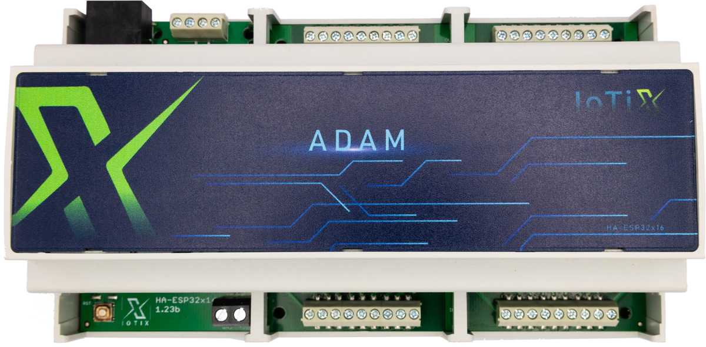

The IoTiX Adam is a DIN-rail ESP32 controller with 16 digital inputs and 16 digital outputs, provided by two onboard
PCF8575 I/O expanders on a shared I2C bus. An expansion slot accepts RS485, Ethernet or KNX daughterboards.

It works with the IoTiX add-ons:

- **P8C**: 8 x 5 A relays, connected over I2C through the RJ45 port
- **NextSwitch**: RS485 wall-switch module
- **NextLight**: 4-channel 0-10 V dimmer over RS485 or Wi-Fi

## GPIO Pinout

| Pin    | Function                                |
| ------ | --------------------------------------- |
| GPIO0  | BOOT button                             |
| GPIO21 | I2C SDA (PCF8575 expanders, P8C add-on) |
| GPIO22 | I2C SCL (PCF8575 expanders, P8C add-on) |

## I/O Expanders

| Expander | I2C address | Pins   | Function                 |
| -------- | ----------- | ------ | ------------------------ |
| PCF8575  | 0x26        | 0 - 15 | Digital outputs DO1-DO16 |
| PCF8575  | 0x27        | 0 - 15 | Digital inputs DI1-DI16  |

Inputs and outputs are active-low, so both are configured with `inverted: true`.

## Basic Configuration

```yaml file=config.yaml
```
