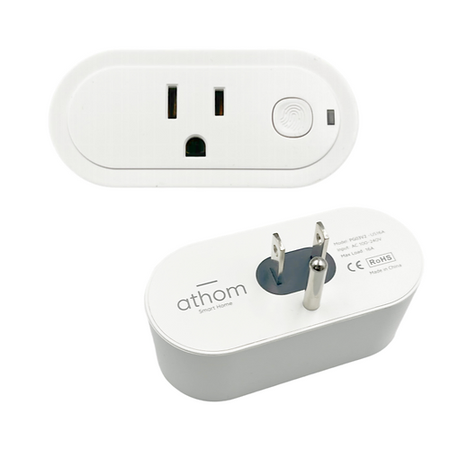

The same plug is sold as **IoTorero** and as **Athom** - IoTorero is a rebranding of Athom, and the hardware and
firmware are identical. Units labelled either way use the configuration below.

Maker: [Athom](https://www.athom.tech/)

Product page: [ESP32-C3 US Plug Made for ESPHome](https://www.athom.tech/blank-1/esp32-c3-us-plug-for-esphome)

## Description

The Athom Smart Plug US V3 is a 16 A US smart plug pre-installed with ESPHome for local control through Home
Assistant. It provides relay control and energy monitoring without requiring a cloud service.

## Features

- ESP32-C3 with 4 MB flash
- 2.4 GHz Wi-Fi and Bluetooth Low Energy proxy
- Voltage, current, power, power factor, and energy monitoring
- 16 A maximum load with over-current shutoff
- Configurable power-on state
- Local Home Assistant integration and managed OTA updates

The manufacturer's configuration requires ESPHome 2026.6.0 or newer.

## GPIO Pinout

| Pin    | Function   |
| ------ | ---------- |
| GPIO20 | CSE7766 Rx |
| GPIO3  | Button     |
| GPIO5  | Relay      |
| GPIO6  | Status LED |

## Configuration

```yaml url=https://github.com/athom-tech/esp32-configs/blob/main/athom-smart-plug.yaml
```
