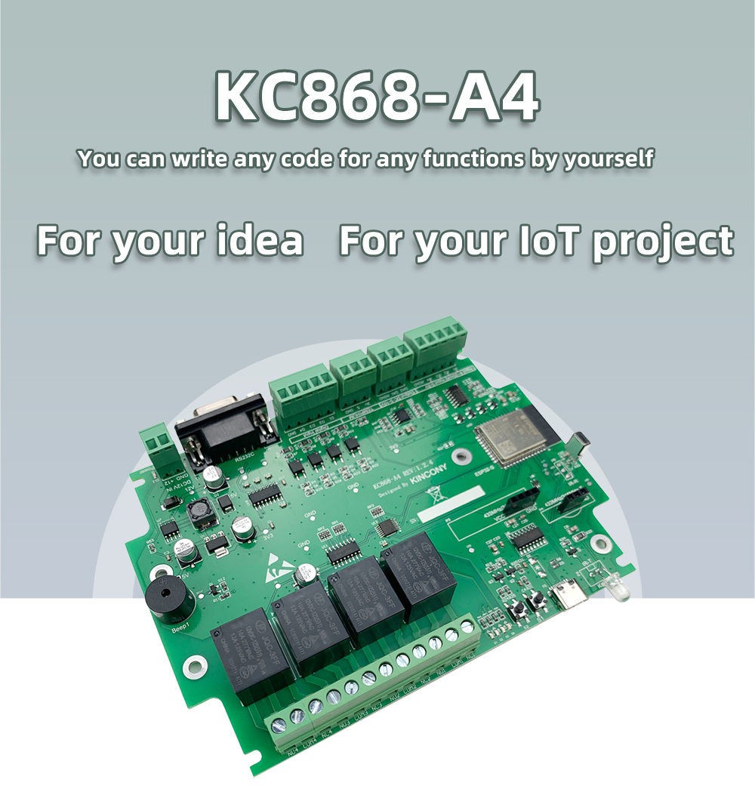

## GPIO Pinout

| Pin    | Function           |
| ------ | ------------------ |
| GPIO2  | Relay1             |
| GPIO15 | Relay2             |
| GPIO5  | Relay3             |
| GPIO4  | Relay4             |
| GPIO2  | digital input1     |
| GPIO15 | digital input2     |
| GPIO5  | digital input3     |
| GPIO4  | digital input4     |
| GPIO32 | analog input1      |
| GPIO33 | analog input2      |
| GPIO34 | analog input3      |
| GPIO35 | analog input4      |
| GPIO25 | analog output1     |
| GPIO26 | analog output2     |
| GPIO13 | 1-Wire GPIO        |
| GPIO18 | beep               |
| GPIO16 | RS232_RXD          |
| GPIO17 | RS232_TXD          |
| GPIO21 | 433MHz Transmitter |
| GPIO19 | 433MHz Receiver    |
| GPIO23 | IR Receiver        |
| GPIO22 | IR Transmitter     |
| GPIO0  | PCB Button         |

[Additional pinout/design details](https://www.kincony.com/arduino-esp32-4-channel-relay-module.html)

## Basic Configuration

```yaml
# Basic Config by Gaetan Caron

substitutions:
  number: "1"
  device_name: kc868-a4-${number}
  device_description: Kincony kc868-a4 
  friendly_name: kc868-a4 ${number}

esphome:
  name: ${device_name}
  comment: ${device_description}
esp32:
  variant: esp32

# Enable logging
logger:

# Enable Home Assistant API
api:
  encryption:
    key: "your api key"

ota:
  password: "your ota password"

wifi:
  ssid: "KinCony"
  password: "a12345678"

  # Enable fallback hotspot (captive portal) in case wifi connection fails
  ap:
    ssid: "Kc868-A4 Fallback Hotspot"
    password: "1234Ab"
text_sensor:
  - platform: wifi_info
    ip_address:
      name: ESP IP Address
    ssid:
      name: ESP Connected SSID
    bssid:
      name: ESP Connected BSSID
    mac_address:
      name: ESP Mac Wifi Address
captive_portal:

one_wire:
#enable temperature bus
  - platform: gpio
    pin: 13

switch:
  - platform: gpio
    name: "Relay 1"
    pin: 2
    inverted: false

  - platform: gpio
    name: "Relay 2"
    pin: 15
    inverted: false

  - platform: gpio
    name: "Relay 3"
    pin: 5
    inverted: false

  - platform: gpio
    name: "Relay 4"
    pin: 4
    inverted: false
# enable use of internal buzzer
  - platform: gpio
    id: buzzer
    name: "buzzer" 
    pin: 18

binary_sensor:
  - platform: gpio
    name: "input1"
    pin:
      number: 36
      inverted: true
  
  - platform: gpio
    name: "input2"
    pin:
      number: 39
      inverted: true

  - platform: gpio
    name: "input3"
    pin:
      number: 27
      inverted: true

  - platform: gpio
    name: "input4"
    pin:
      number: 14
      inverted: true
# enable use of internal button
  - platform: gpio
    pin: 
      number: 0 
      inverted: true
      mode: INPUT_PULLUP
    name: "PCB Button"

sensor:
# statistic sensor for convenience
  - platform: uptime
    name: ${friendly_name} Uptime
    unit_of_measurement: minutes
    filters:
      - lambda: return x / 60.0;

  - platform: wifi_signal
    name: ${friendly_name} Signal
    update_interval: 60s

#ds18b20 on temperature external bus
  - platform: dallas_temp
    address: #sensor address
    resolution: 12
    name: "t#1"
    accuracy_decimals: 3
    update_interval: 1000ms
#analog input, calibrate with your board
  - platform: adc
    pin: 32
    attenuation: auto
    name: "Ain 3"
    filters:
      - calibrate_linear:
         method: exact
         datapoints:
          # Map sensor value vs true value to calibrate volt
          - 0.07 -> 0.0
          - 0.24 -> 0.347
          - 3.13 -> 4.65
    update_interval: 1s

  - platform: adc
    pin: 33
    attenuation: auto
    name: "Ain 4"
    filters:
      - calibrate_linear:
         method: exact
         datapoints:
          # Map sensor value vs true value to calibrate volt
          - 0.07 -> 0.0
          - 0.24 -> 0.347
          - 3.13 -> 4.65
    update_interval: 1s
 
  - platform: adc
    pin: 34
    attenuation: auto
    unit_of_measurement: "Ma"
    name: "Ain 1"
    filters:
      - calibrate_linear:
         method: exact
         datapoints:
         # Map sensor value vs true value to calibrate current
          - 0.07 -> 0.0
          - 0.34 -> 2.24
          - 3.03 -> 20.12
    update_interval: 1s


  - platform: adc
    pin: 35
    attenuation: auto
    unit_of_measurement: "Ma"
    name: "Ain 2"
    filters:
      - calibrate_linear:
         method: exact
         datapoints:
          # Map sensor value vs true value to calibrate current
          - 0.07 -> 0.0
          - 0.34 -> 2.24
          - 3.03 -> 20.12
    update_interval: 1s


#dac use basic
output:

  - platform: esp32_dac
    pin: 25
    id: "Aout1"
 
  - platform: esp32_dac
    pin: 26
    id: "Aout2"
  
light:
  
  - platform: monochromatic
    output: Aout1
    name: "Aout1"
    gamma_correct: 0
    id: Aout_1

  
  - platform: monochromatic
    output: Aout2
    name: "Aout2"
    gamma_correct: 0
    id: Aout_2
```
