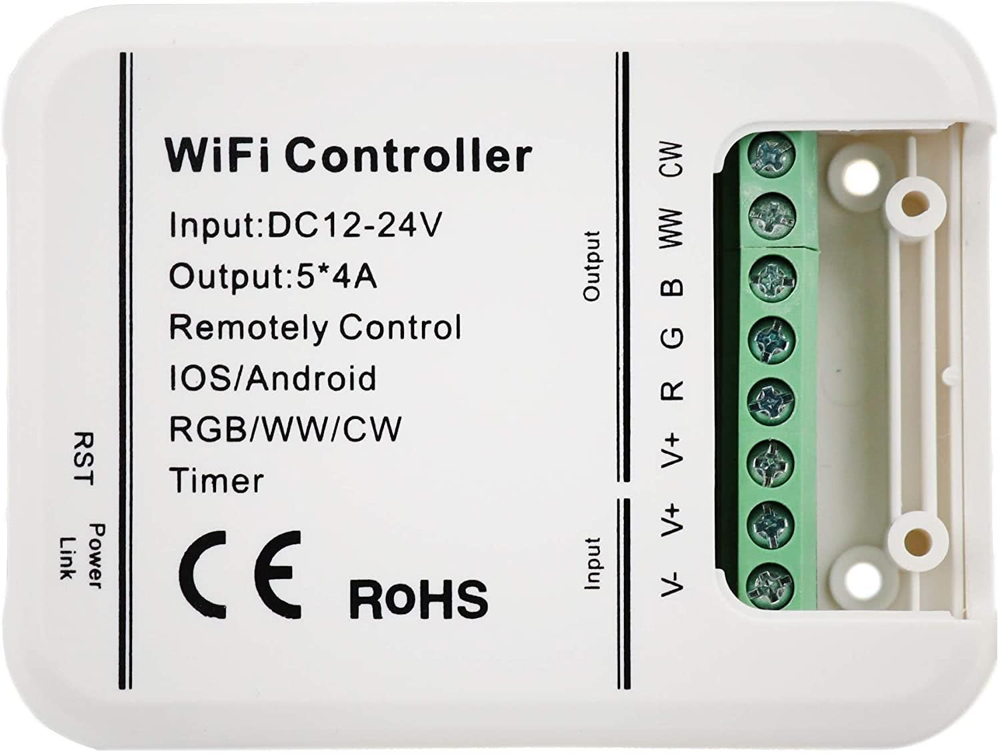

## General Notes

LEDENET Smart WiFi LED controller compatible with MagicHome.

Manufacturer: [LEDENET](https://www.ledenet.com/)



## GPIO Pinout

| Pin    | Function           |
| ------ | ------------------ |
| GPIO0  | Reset Button       |
| GPIO2  | Link LED (Green)   |
| GPIO14 | Red Channel        |
| GPIO12 | Green Channel      |
| GPIO13 | Blue Channel       |
| GPIO5  | Cold White Channel |
| GPIO15 | Warm White Channel |

## RGB/WW/CW Config

```yaml file=config.yaml
```

## RGBW Config

```yaml file=rgbw-config.yaml
```

## RGB Config

```yaml file=rgb-config.yaml
```

## Optional features

Download the selected YAML files into the same directory and include them as local packages alongside one of the
hardware configurations above.
Add your Wi-Fi credentials in your own configuration.

Home Assistant API and OTA updates:

```yaml file=home-assistant.yaml
```
