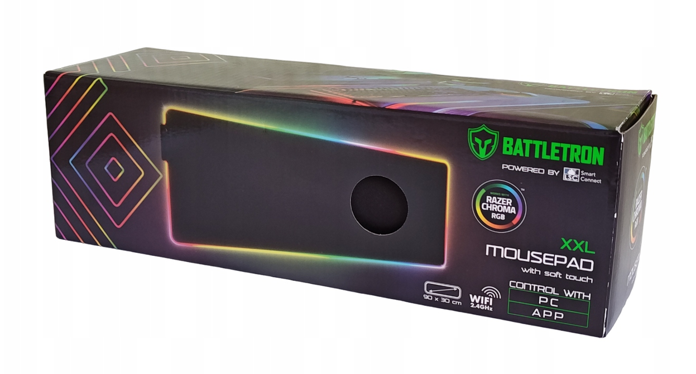
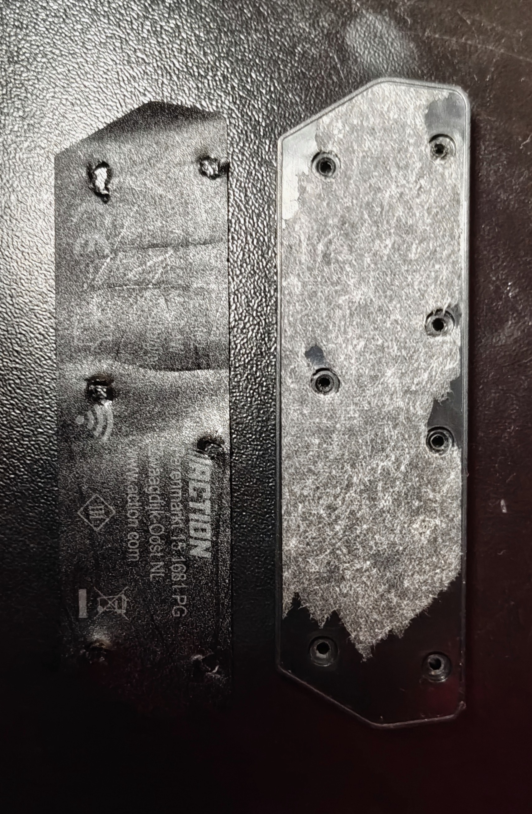
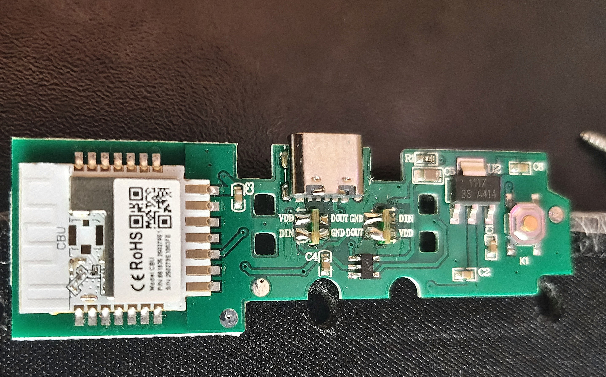

## General Notes

This configuration is for the LSC Battletron XXL Mousepad


## Warning

The LEDs on this product are quite dim and do not resemble the picture on the box,
if you're buying this product, maybe reconsider.
If you are fine with this then proceed.

## Disassembly

To get into this product you need to unscrew 7 Phillips head screws hidden beneath the bottom sticker.

To unscrew them you either need to damage the bottom sticker or remove it and have to glue it again.



## How to flash

To flash the controller, open up the controller and take the board out.



Use a Tuya CBU module pinout to locate `TX1`, `RX1`, and `GND` on the back of the board.
Connect module `TX1` to the flasher's RX, module `RX1` to its TX, and board `GND` to the flasher's GND.
Use 3.3 V UART logic even when powering the board through its 5 V USB input.
Optionally, solder a wire to `CEN` to make resetting the module easier or use a jumper wire.
Shorting the `CEN` Pin is required to enter download mode

Alternatively you can try to use some wires, tape and some pins and hold them to the required points.
This is not recommended but is possible if soldering is not an option.

Powering the board from regular 5V USB to flash is fine, I used a Raspberry Pi to flash my chip.

### To take a backup

If you are using the CLI tool take a backup using:

```bash
ltchiptool flash read bk7231n <backupname>
```

### To flash the chip

1. Create an empty configuration with either only hardware definitions or the ready config.
2. Download the compiled firmware file
3. If you are using the CLI tool flash the chip using:

```bash
ltchiptool flash write <firmwarefile>
```

## GPIO Pinout

| Pin | Function |
| :---: | :--------------: |
| P6 | Button |
| P16 | 2 WS2812 Leds |

### YAML Config

Bare hardware definitions

```yaml file=config.yaml
```

#### A ready config with light effects

```yaml file=full-config.yaml
```
