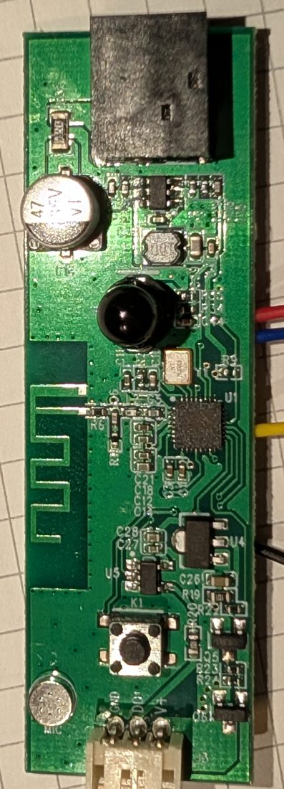

## General Notes

This is the newer revision of the
[LSC Smart Connect Ledstrip RGBIC + CCTIC](/devices/LSC-ledstrip-rgbic-cctic/) (Action article 3203632).
The strip itself looks the same, but the controller board is different and so is the pinout,
so the config for the 3203632.1 leaves this one completely dark.

How to recognise it: the controller PCB is marked `RGBMICIR_V1.0 2024.06.21` and it has a 3-pin
connector to the strip (GND / DO / V+). The BK7231N is soldered directly on the board.



")

The strip has 25 segments of 20 cm. Each segment has two SM16703 chips: one for the RGB LEDs
(even addresses) and one for the white LEDs (odd addresses), so 50 addresses in total.
On the white chips, channel 1 is unused, channel 2 is warm white and channel 3 is cold white.

## GPIO Pinout

| Pin | Function                             |
| --- | ------------------------------------ |
| P16 | Data (SM16703, colour order RBG)     |
| P22 | 24 V power for the strip (high = on) |
| P26 | IR receiver (not tested)             |

Microphone and button pins are not known yet.

## Flashing

The Tuya firmware (1.0.2 on my unit) is not supported by tuya-cloudcutter, so it has to be flashed
over UART. The back of the board has labelled pads: CEN, 1TX, 1RX, 2TX, GND, 3.3V, P21, P1.
Use 1TX, 1RX, 3.3V and GND, with the 24 V supply disconnected. I used ltchiptool with a CP2102
adapter, and restarted the chip by briefly disconnecting 3.3V.

## Notes

- The `e131` effect on the RGB partition works for ambilight with HyperHDR or Hyperion
  (25 RGB pixels, universe 1). The RGB partition uses `gamma_correct: 1.0` for that:
  with the default 2.8, dim colours almost disappear.
- `config.yaml` exposes the white chips as an RGB-style light (blue = warm, green = cold).
  The optional `white-color-temperature.yaml` adds a proper colour temperature light on top of it.
- Pinout first reported in the
  [Home Assistant community](https://community.home-assistant.io/t/using-lsc-3203632-1-rgbic-cctic-ledstrip-with-esphome/812822/35)
  and in an [OpenBeken template on Elektroda](https://www.elektroda.com/rtvforum/topic4136779.html).

## Configuration

```yaml file=config.yaml
```

## Colour temperature light for the white LEDs (optional)

```yaml file=white-color-temperature.yaml
```
