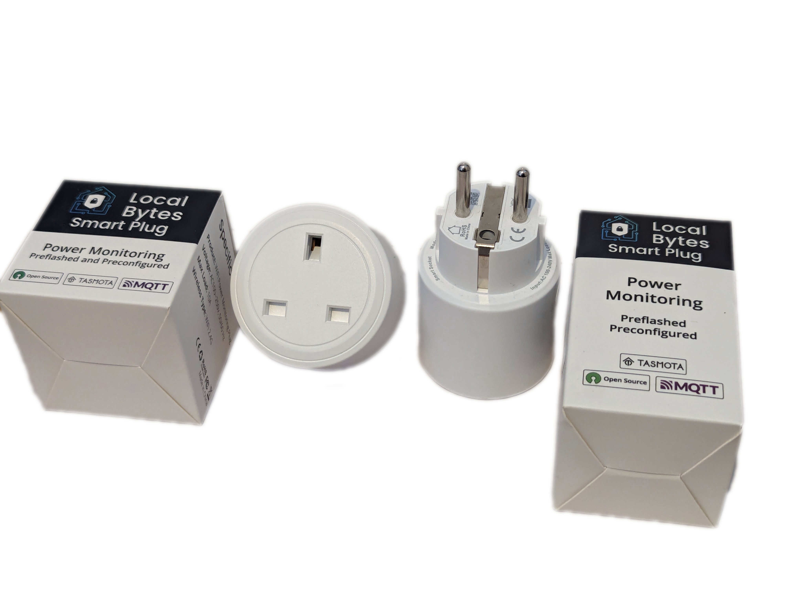

Maker: [https://mylocalbytes.com/](https://mylocalbytes.com/)

Preflashed with ESPHome or Tasmota

## GPIO Pinout

| Pin    | Function   |
| ------ | ---------- |
| GPIO3  | Button     |
| GPIO4  | BL0937 CF  |
| GPIO5  | HLWBL CF1  |
| GPIO12 | HLWBL SELi |
| GPIO13 | LedLink    |
| GPIO14 | Relay      |

## Basic Configuration

```yaml
substitutions:
  name: localbytes-plug-pm-<NAME>
  friendly_name: Localbytes Plug PM <NAME>

packages:
  localbytes.plug-pm: github://LocalBytes/esphome-localbytes-plug/localbytes-plug-pm.yaml@main

esphome:
  name: ${name}
  name_add_mac_suffix: false
  friendly_name: ${friendly_name}
  
# OTA flashing
ota:
  - platform: esphome

wifi: # Your Wifi network details
  
# Enable fallback hotspot in case wifi connection fails  
  ap:

# Enabling the logging component
logger:

# Enable Home Assistant API
api:

# Enable the captive portal
captive_portal:

```
