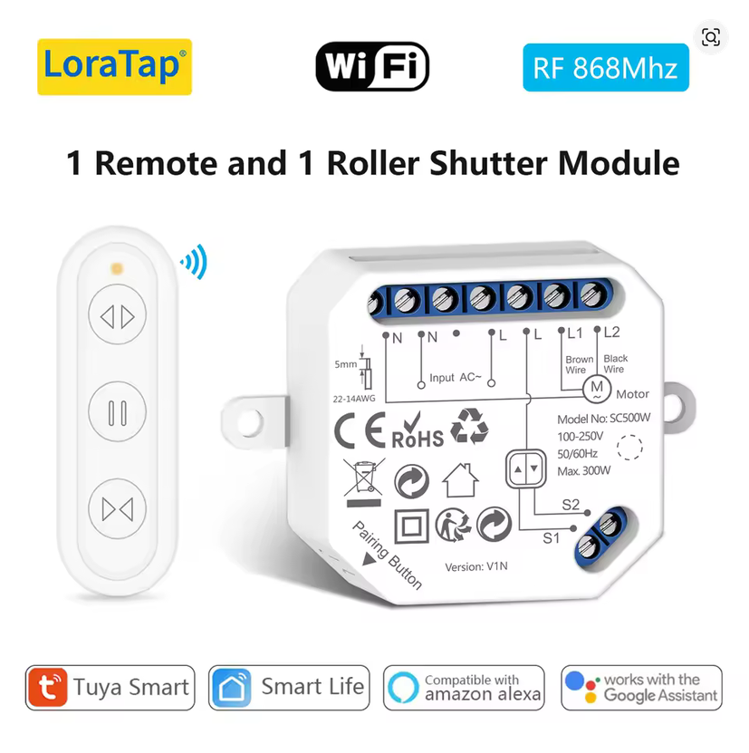
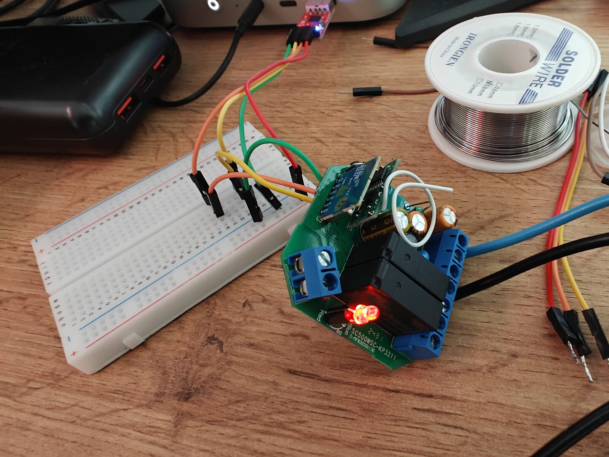

## Product Description

In-wall roller shutter / curtain relay sold by LoraTap, based on a Tuya CB2S module
with a Beken BK7231N SoC. It has two relays (up/down) and inputs for physical wall buttons.

The original RF remote works at 868 MHz with an independent receiver, so it keeps working
after flashing ESPHome (its signal is not readable by the module anyway).

## Product Images




## Flashing

The CB2S module is flashed via UART with [ltchiptool](https://docs.libretiny.eu/docs/flashing/tools/ltchiptool/).
Things to keep in mind with Beken chips:

1. Work with the board **fully disconnected from mains** and power the module from an isolated
   3.3 V supply rated for at least 500 mA. The 3.3 V rail of most USB-UART adapters cannot power
   the module reliably during flashing (brownouts on flash erase), so use a dedicated supply, or
   desolder the CB2S module and flash it on its own.
2. If the module only powers up reliably on the board, the board must still be fed from a supply
   that is galvanically isolated from mains, and you must be able to confirm it (for example an
   isolated bench supply). A mains-referenced supply puts hazardous voltage on GND, RX and TX, and
   therefore on the USB adapter and the computer. A USB isolator between the adapter and the computer
   protects the computer only: the adapter leads and the pads on the board stay live. If you cannot
   verify the isolation, do not flash the board while it is powered. Desolder the CB2S module, or use
   an isolated bench supply with the mains input disconnected.
   **Never connect the 3.3 V line of the USB-UART adapter while the board is powered.**
3. Launch the flash command first, it waits for the chip.
4. While the command is running, briefly bridge CEN to GND and release it. CEN is the reset pin, so
   holding it to GND keeps the chip in reset and the tool never connects. If the tool reports
   `No response received`, run the command again and repeat the reset a little later.

**Warning: this device works with mains voltage. Take all necessary precautions and never work on it
while it is connected to mains.**
**Never short P26 (or any relay pin) to GND: it destroys the module.**

## GPIO Pinout

| Pin | Function        |
| --- | --------------- |
| P24 | Up relay        |
| P26 | Down relay      |
| P23 | Up button       |
| P21 | Down button     |
| P7  | Stop button     |
| P10 | Onboard LED     |

Pin naming on Beken chips is `P6`, `P7`, `P8`..., not `GPIOxx`.

## Basic Configuration

The config below uses scripts with a 500 ms gap between directions instead of the `cover`
component, which causes interlock issues after a stop on this hardware, plus a 60 s safety
timeout that always turns both relays off.

```yaml file=config.yaml
```

## Links

- [Full firmware with position tracking, calibration times and direction invert](https://github.com/gnacho/esphome-loratap-curtain-cb2s)
- [CB2S pinout and documentation (LibreTiny)](https://docs.libretiny.eu/boards/cb2s/)
