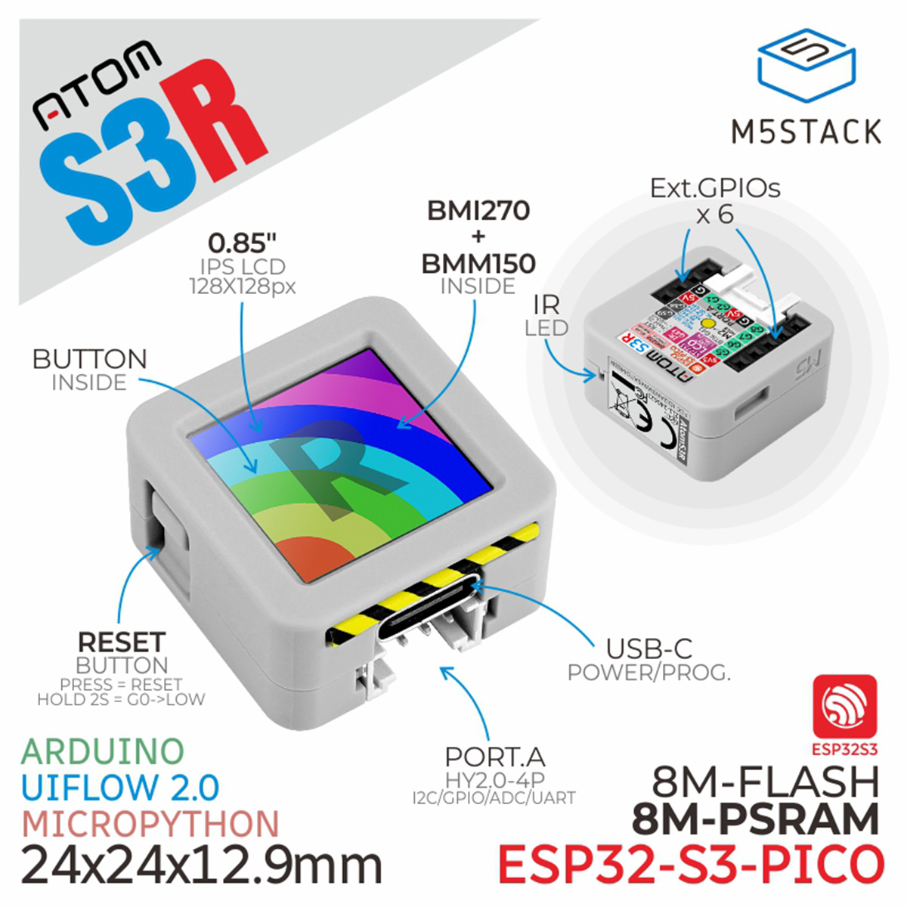

## Product Description

The M5Stack AtomS3R is a compact ESP32-S3 development board featuring:

- ESP32-S3 microcontroller (Xtensa dual-core 32-bit LX7)
- 128x128 GC9107 LCD display
- BMI270 6-axis IMU with a BMM150 magnetometer wired through its auxiliary I2C interface
- LP5562 LED driver for the display backlight
- USB-C connector
- Grove connector for expansion
- Single programmable button

Available from [M5Stack](https://docs.m5stack.com/en/core/AtomS3R).

## GPIO Pinout

| Pin     | Function       |
| ------- | -------------- |
| GPIO 0  | I2C SCL        |
| GPIO 1  | Grove (white)  |
| GPIO 2  | Grove (yellow) |
| GPIO 14 | Display CS     |
| GPIO 15 | SPI CLK        |
| GPIO 21 | SPI MOSI       |
| GPIO 41 | Button         |
| GPIO 42 | Display DC     |
| GPIO 45 | I2C SDA        |
| GPIO 47 | IR LED         |
| GPIO 48 | Display Reset  |

## I2C Devices

| Address | Device                       |
| ------- | ---------------------------- |
| 0x30    | LP5562 (Display Backlight)   |
| 0x68    | BMI270 (IMU)                 |

The BMM150 magnetometer at 0x10 is accessed via the BMI270's auxiliary I2C interface rather than
appearing directly on the main bus.

## Basic Configuration

This configuration requires ESPHome 2026.11 or newer, which adds the BMM150 support for the `bmi270` platform and the
`lp5562` output component.

If the BMI270 fails to read over I2C, uncomment the `build_flags: -DI2C_BUFFER_LENGTH=8193` line in the `esphome:`
block to enlarge the Arduino I2C buffer.

The display uses the `mipi_spi` platform with the built-in `M5STACK-ATOMS3R-GC9107` model, which already
supplies the correct dimensions, offsets, and pin assignments for this board's GC9107 controller. That model
declares a dependency on PSRAM, so a `psram:` block (`mode: octal`, matching the AtomS3R's 8MB Octal PSRAM) is
required. `speed` defaults to the lowest speed the ESP32-S3 supports (40MHz) if omitted, so it's set explicitly
to `80MHz` here to match the chip's rated PSRAM speed.

> **Note:** M5Stack changed the AtomS3R's display driver IC from GC9107 to ST7735 on 2026-05-14. The
> config below targets the original GC9107 chip (units sold before that date); units bought since then may
> ship with an ST7735 driver instead, which isn't yet covered by an M5Stack-specific `mipi_spi` model and
> would need pins/dimensions/offsets specified manually. Check your unit's driver IC before relying on this
> config as-is.

`rotation` is relative to the USB-C port: `0` (the default) has the port at the top, `180` puts it at the
bottom, `90` at the left, and `270` at the right.

```yaml file=config.yaml
```

## Display All Sensor Values

The basic configuration above only prints "Hello World!" on the display. To turn it into a small
IMU dashboard, add the file below. It adds a smaller font (the default 20pt font is too large to fit ten
readings on a 128x128 screen) and replaces the `display:` lambda with one that prints the accelerometer,
gyroscope, magnetometer, temperature, and current backlight brightness:

```yaml file=sensor-dashboard.yaml
```

## Use Cases

- **IMU applications**: Motion sensing, orientation detection
- **Status displays**: Show sensor data or Home Assistant state on the built-in display
- **Compact IoT projects**: Small form factor with a display, IMU, and expansion port built in

## Resources

- [M5Stack AtomS3R Documentation](https://docs.m5stack.com/en/core/AtomS3R)
- [BMI270 Motion Platform](https://esphome.io/components/motion/bmi270/)
- [ESP32-S3 Datasheet](https://www.espressif.com/sites/default/files/documentation/esp32-s3_datasheet_en.pdf)
