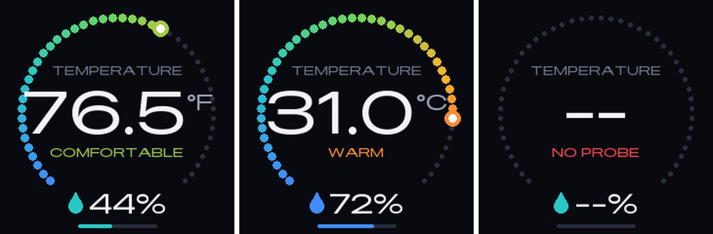

")

The MOCREO NS2 is a direct Wi-Fi temperature and humidity monitor with a 240x240 colour IPS screen. The probe
variant carries a Sensirion SHT40 in an external probe that plugs into a second USB-C socket. Inside is a bare
ESP32-C3 with 4 MB of embedded flash, and flash encryption and secure boot are both off, so it can be flashed over
USB with no disassembly.

This page covers the probe variant with board revision `NS2_V2.1`, sold on
[Amazon](https://www.amazon.com/dp/B0FP4KZKPG).

## Hardware

| Part    | Detail                                                                           |
| ------- | -------------------------------------------------------------------------------- |
| SoC     | ESP32-C3 (QFN32), 4 MB embedded flash, no PSRAM                                  |
| Display | 240x240 ST7789 IPS, 4-wire SPI, 10-pin FPC                                       |
| Sensor  | Sensirion SHT40 at I²C `0x44`, inside the external probe                         |
| Ports   | U12 USB-C: power and USB-Serial-JTAG (flashing). U3 USB-C: probe connector only  |
| Other   | Piezo buzzer, one button, AO3402 N-MOSFET backlight switch, 3.3 V LDO            |

## GPIO pinout

| Pin    | Function    | Notes                                                 |
| ------ | ----------- | ----------------------------------------------------- |
| GPIO1  | I²C SCL     | To the probe via U3                                   |
| GPIO2  | I²C SDA     | To the probe via U3                                   |
| GPIO3  | Backlight   | Active high, PWM into a low-side MOSFET gate          |
| GPIO4  | LCD DC      |                                                       |
| GPIO5  | LCD CS      |                                                       |
| GPIO6  | SPI SCLK    | SPI2 at 10 MHz                                        |
| GPIO7  | SPI MOSI    | No MISO                                               |
| GPIO8  | LCD RST     | Has a pull-up                                         |
| GPIO9  | Button      | Active low, external pull-up. Also the boot strap pin |
| GPIO18 | USB D-      | USB-Serial-JTAG on U12                                |
| GPIO19 | USB D+      | USB-Serial-JTAG on U12                                |
| GPIO20 | Buzzer      | Piezo                                                 |

## Flashing

1. Back up the stock firmware first, with U12 connected to your computer:
   `esptool.py --chip esp32c3 read_flash 0 0x400000 ns2_stock_backup.bin`.
   Writing that file back at `0x0` restores the original firmware.
2. Flash over USB (U12) from the ESPHome Device Builder or [ESPHome Web](https://web.esphome.io). If the board is
   not detected, hold the button while plugging in the cable to force download mode. Later updates can go over the
   air.

Do not hold the button while powering the device on in normal use: GPIO9 is the boot strapping pin.

## Notes

- **RAM:** the ESP32-C3 has no PSRAM, and a full 240x240 16-bit framebuffer (115 KB) does not fit as one block
  with Wi-Fi running. Use `buffer_size: 25%` on the display, as below.
- **Probe:** with no probe in U3 the SHT40 is absent and the I²C scan finds nothing.
- **Backlight heat:** the panel runs warm at full brightness, so a lower default brightness is a good idea.

## Basic configuration

This is the hardware definition only. The display shows ESPHome's test card until you add a `lambda:` or LVGL.

```yaml file=config.yaml
```

## Full configuration

A complete config with a temperature and humidity dashboard, °F/°C switching and backlight steps on the button,
and a screen rotation select is in the [project repository](https://github.com/chunckus-aurelius/MOCREO-NS2-ESPhome).



Dashboard layout (render). Left to right: a °F reading, a warm °C reading, and no probe connected.

```yaml url=https://github.com/chunckus-aurelius/MOCREO-NS2-ESPhome/blob/83fe6bf137c09f24c4203b19775c91ccb661b36c/esphome/mocreo-ns2.yaml
```
