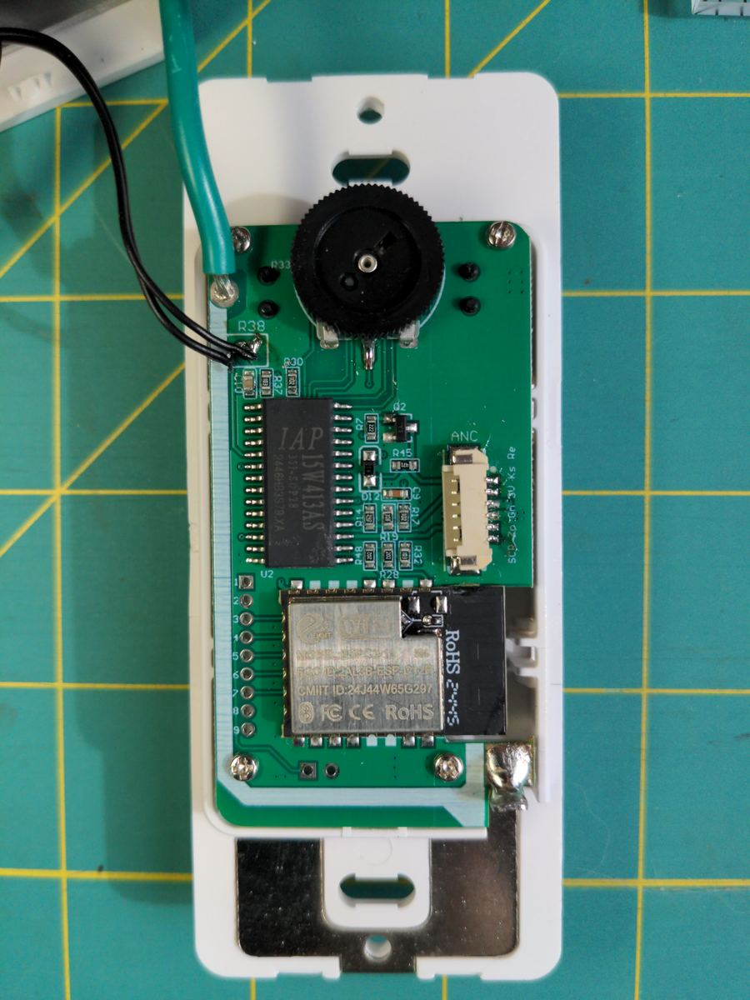

## Description

The Martin Jerry RP-STD01 is a 3-way dimmer kit: a master unit that switches and dims the lamp, and a passive add-on
switch for the second location. It ships with Tasmota 13.0.0 ("STD01 by MJ").

[Amazon Link](https://www.amazon.com/dp/B0DT74K641)

This is a newer design than the [Martin Jerry STD01](/devices/Martin-Jerry-STD01/), which uses an ESP8266 and Tuya
firmware. The flashing steps and pins on that page do not apply to this one.

The master unit's control board has two chips:

- an **ESP32-C3** module (DOIT ESP-C3-12F, 4 MB flash), which only handles Wi-Fi;
- an **STC IAP15W413AS** microcontroller (MCU), which runs the triac, the relay, the buttons, the LEDs, the
  thumbwheel, the add-on switch and the over-temperature protection.

They talk over the Tuya MCU serial protocol at 115200 baud. Factory Tasmota was set to 9600 baud on one of the devices
tested, which resulted in no control via the web interface.



> **Safety:** the low-voltage side is not isolated from mains. Treat everything inside the case as live whenever the
> device is connected to mains.

## GPIO Pinout

| Pin    | Function                 |
| ------ | ------------------------ |
| GPIO20 | UART RX, from the MCU    |
| GPIO21 | UART TX, to the MCU      |

GPIO20 and GPIO21 are UART0, so the configuration sends the log to the USB port instead.

## Stock MCU Datapoints

| Datapoint | Type | Function             |
| --------- | ---- | -------------------- |
| 1         | bool | Power                |
| 2         | int  | Brightness, 1 to 100 |

The stock MCU firmware reports nothing else: there is no datapoint for the night light, the buttons, the add-on
switch, the thumbwheel or the temperature. Its limits:

- Brightness 1 and 2 make the lamp sweep up and down instead of dimming, so the configuration starts at 3.
- Brightness 100 is not full brightness: the paddle's UP button goes brighter than any value that can be sent.
- The thumbwheel sets the overall range. At its dim end, values 3 to 5 can flicker; raise `min_value` if they do.
- The MCU fades on its own.

The configuration below has run on one unit but has not been tested in depth.

## Flashing From Tasmota

The case does not need to be opened. Follow ESPHome's
[Migrating from Tasmota](https://esphome.io/guides/migrate_sonoff_tasmota/) guide, including its ESP32 partition
table migration, with `config.yaml` (below) and your own Wi-Fi, `api:` and `ota:` settings. As the guide says, the
`ota:` block needs `allow_partition_access: true` until the partition table is migrated.

This has been tried only from the factory Tasmota 13.0.0. Pick the guide's migration method from the `Used size`
in the log, as it describes. ESPHome then warns that OTA rollback is not supported, because Tasmota's bootloader
stays; this is harmless.

## Configuration

```yaml file=config.yaml
```

## Open MCU Firmware

[rp-std01-esphome](https://github.com/bdm310/rp-std01-esphome) replaces the MCU's firmware with an open one that
only handles the triac timing and safety, and moves everything else to ESPHome: the night light, button events for
the paddle and the add-on switch, the thumbwheel and the heatsink temperature all become entities.

The change is one-way: the factory MCU firmware cannot be backed up. See the project's README to
install. The install also works from a unit already moved to ESPHome with this page, with no further partition
table change.
