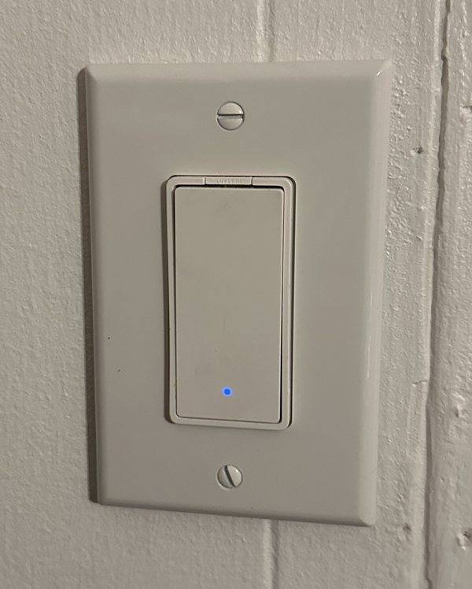

[Amazon Link](https://www.amazon.com/dp/B09C1R7PDK)

[Device on Martin Jerry](https://www.martinjerry.com/us-ss01-support)

## Hardware versions

The US-SS01 has shipped with two different modules, and the pinouts are **not** compatible. Check which one you have
before flashing. The stock Tasmota web UI shows the chip on its **Information** page (`ESP8266EX`/`ESP8285` vs.
`ESP32-C3`).

- [ESP8285 version](#esp8285-version)
- [ESP32-C3 version](#esp32-c3-version): Tasmota reports `13.0.0(US-SS01 by MJ)`, `ESP32-C3`, template name
  `US-SS01 Switch`

## ESP8285 version

### ESP8285 GPIO Pinout

| Pin    | Function |
| ------ | -------- |
| GPIO3  | button   |
| GPIO5  | relay    |
| GPIO12 | red LED  |
| GPIO14 | blue LED |

### ESP8285 Configuration

```yaml file=config.yaml
```

## ESP32-C3 version



### ESP32-C3 GPIO Pinout

| Pin    | Function                                    |
| ------ | ------------------------------------------- |
| GPIO20 | button (active low, needs internal pull-up) |
| GPIO7  | relay                                       |
| GPIO2  | LED (inverted)                              |

Stock Tasmota template on this version:

```json
{"NAME":"US-SS01 Switch","GPIO":[0,0,321,0,0,0,0,224,0,0,0,0,0,0,0,0,0,0,0,0,32,0],"FLAG":0,"BASE":1}
```

**Important:** keep `logger: baud_rate: 0` from the configuration below. On the tested unit, the same configuration
with the default logger settings left the button unresponsive, though the relay still worked from Home Assistant.
Adding `baud_rate: 0` was the only change needed to fix it. GPIO20 is the ESP32-C3's UART0 RX pin. The exact
interaction wasn't investigated further, since ESPHome's ESP32-C3 logger defaults to USB Serial/JTAG. Logs are still
available over the API.

### ESP32-C3 Configuration

```yaml file=esp32c3.yaml
```

### Migrating from the preinstalled Tasmota over the air

This version ships with Tasmota 13 using the ESP32 "safeboot" partition layout. It can be moved to ESPHome over Wi-Fi
without opening the switch by following
[Migrating from Tasmota](https://esphome.io/guides/migrate_sonoff_tasmota/). This has been done on this device:

1. Build a minimal first image: only `esphome`, `esp32`, `logger`, `api`, `ota` and `wifi`, with
   `allow_partition_access: true` under the `ota:` entry. With ESP-IDF this came to about 800 KB, under the 851,968-byte
   limit for the guide's direct method.
2. Upload `firmware.ota.bin` through Tasmota's **Firmware Upgrade → Upgrade by file upload**.
3. Push ESPHome's partition table:
   `esphome upload --partition-table --file partitions_esphome.bin <config>.yaml`
4. Remove `allow_partition_access`. Merge the hardware and logger settings from `esp32c3.yaml` into the working
   migration configuration, keeping its `wifi:`, `api:` and `ota:` sections, then install it over normal OTA.
   Installing `esp32c3.yaml` on its own would leave the switch without Wi-Fi credentials or OTA.

Afterwards ESPHome logs `Bootloader too old for OTA rollback`, because the bootloader is still Tasmota's. This is
harmless; only a serial flash replaces it.
