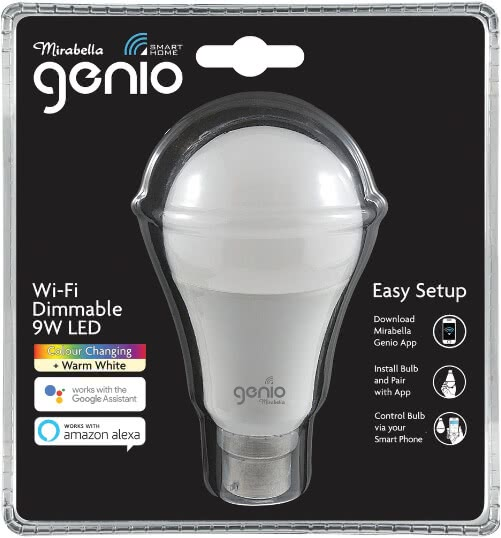

The Mirabella Genio is a Tuya-based smart bulb sold by Kmart in
Australia.



## Basic Configuration

``` yaml
esphome:
  name: example-device
  friendly_name: Example Device
   
esp8266:
  board: esp01_1m
  
# OTA flashing
ota:
  - platform: esphome

wifi: # Your Wifi network details
  
# Enable fallback hotspot in case wifi connection fails  
  ap:

# Enabling the logging component
logger:

# Enable Home Assistant API
api:

# Enable the captive portal
captive_portal:

output:
  - platform: esp8266_pwm
    id: output_warm_white
    pin: GPIO13
  - platform: esp8266_pwm
    id: output_daylight
    pin: GPIO5

light:
  - platform: cwww
    name: "Mirabella Genio Smart Bulb"
    id: light
    cold_white: output_daylight
    warm_white: output_warm_white
    cold_white_color_temperature: 6500 K
    warm_white_color_temperature: 2700 K

    # Ensure the light turns on by default if the physical switch is actuated.
    restore_mode: ALWAYS_ON
```
