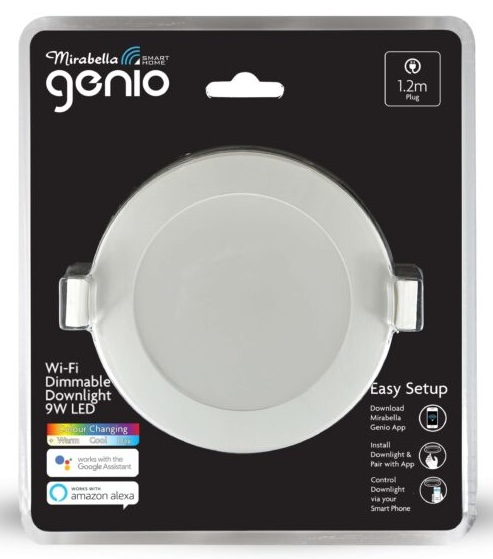

## General Notes

[Mirabella Genio Wi-Fi Dimmable 9W LED CCT Downlight](https://www.mirabella.com.au/products/i002741)



This contains a Tuya Beken Chip CB2L which can be flashed with [ESPHome](https://esphome.io/) and a USB to UART
converter by soldering to the RX and TX pads on the back of the board, plus VCC and GND pins. It is not necassary to
remove the CB2L chip from the unit to flash it.

It might be possible to flash (especially older units) [OTA using tuya-convert](/devices/tuya-convert). If you attempt
to flash a current unit OTA, you should update this page specify if it's still possible or not.

To open the downlight you need to take the difuser out. This can be done with a sharp knife or a small screwdriver buy
may leave minor damage. A suction cup might work to pull it out unharmed.

## Basic Configuration

The example contains the device hardware settings. Add your Wi-Fi, API and OTA configuration separately.

```yaml file=config.yaml
```
