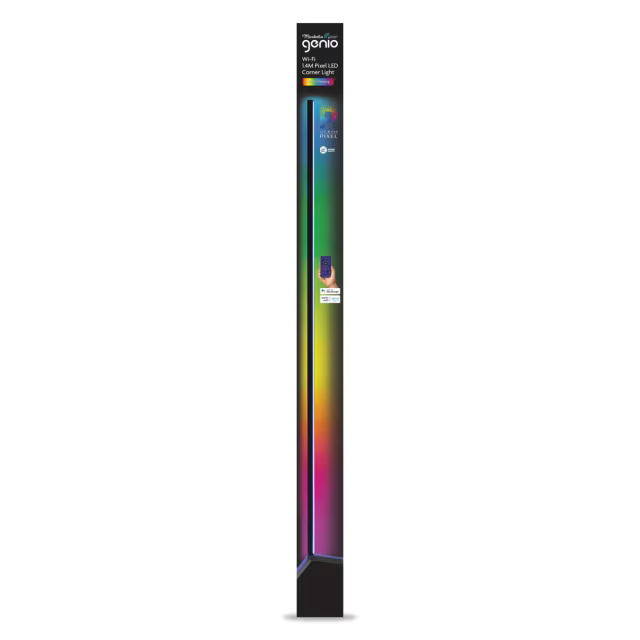
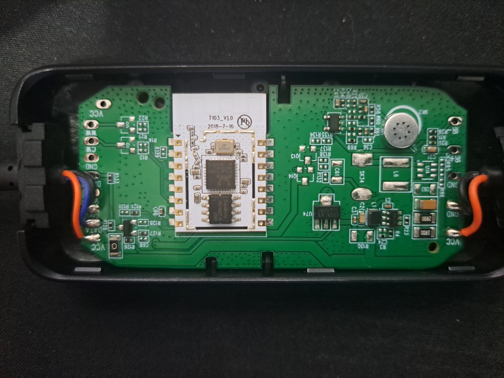

## General Notes

The Mirabella Genio Wi-Fi 1.4m Pixel LED Corner Light is a Tuya-based smart home lamp, featuring a strip of
individually addressable leds with a corner stand frame.



They are sold at [Kmart NZ](https://www.kmart.co.nz/product/mirabella-genio-wi-fi-1.4m-pixel-led-corner-light-43205363/)
and [Kmart AU](https://www.kmart.com.au/product/mirabella-genio-wi-fi-14m-pixel-led-corner-light-43205363/).

Inside is a [T103_V1.0](https://docs.libretiny.eu/boards/t103-v1.0/) module based on the RTL8710BX MCU. I believe this
is prossible to reflash using [LibreTiny](https://docs.libretiny.eu/docs/platform/realtek-ambz/) but I have not done so
myself so do at your own risk. Please update this page if you are successful.



## GPIO Pinout

| Pin   | Function          |
| ----- | ----------------- |
| PA12  | PWR Push Button   |
| PA05  | LED Push Button   |
| PA00  | Sound Push Button |
| PA23? | Light - Data      |

## Basic Configuration

```yaml file=config.yaml
```
