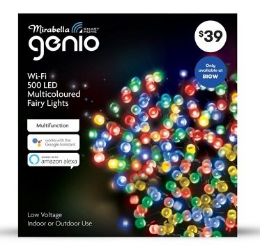

## General Notes

This page covers the Mirabella Genio Wi-Fi 500 LED multicoloured fairy lights pictured below.



## GPIO Pinout

| Pin    | Function       |
| ------ | -------------- |
| GPIO4  | Button LED     |
| GPIO5  | Button         |
| GPIO12 | H-Bridge Pin A |
| GPIO14 | H-Bridge Pin B |

## Basic Configuration

```yaml file=config.yaml
```

## Optional features

Download the selected YAML files into the same directory and include them as local packages alongside `config.yaml`.
Add your Wi-Fi credentials in your own configuration.

Home Assistant API and OTA updates:

```yaml file=home-assistant.yaml
```

Flash the indicator until Wi-Fi connects:

```yaml file=connection-status.yaml
```
