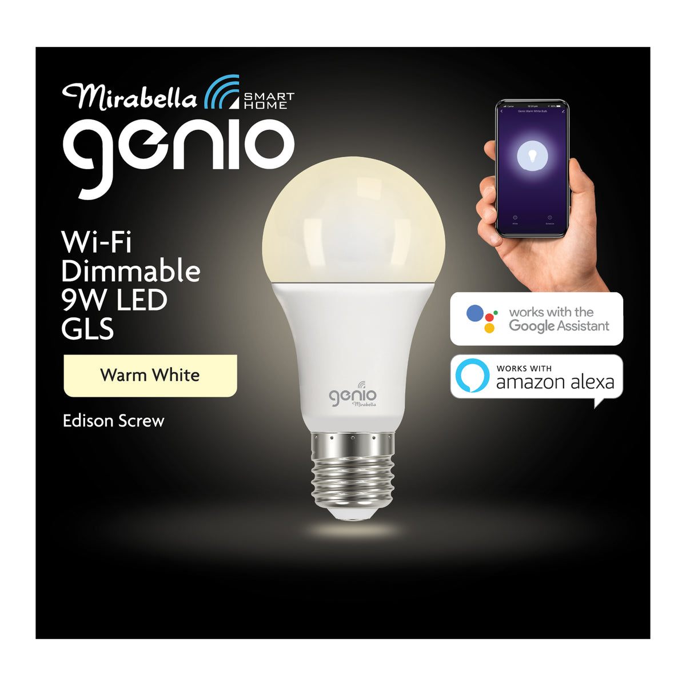

Product image: [Mirabella I002604](https://www.mirabella.com.au/products/i002604).

## GPIO Pinout

| Pin        | Function |
| ---------- | -------- |
| GPIO14 PWM | Light    |

## Basic Configuration

The example contains the device hardware settings. Add your Wi-Fi, API and OTA configuration separately.

```yaml file=config.yaml
```
