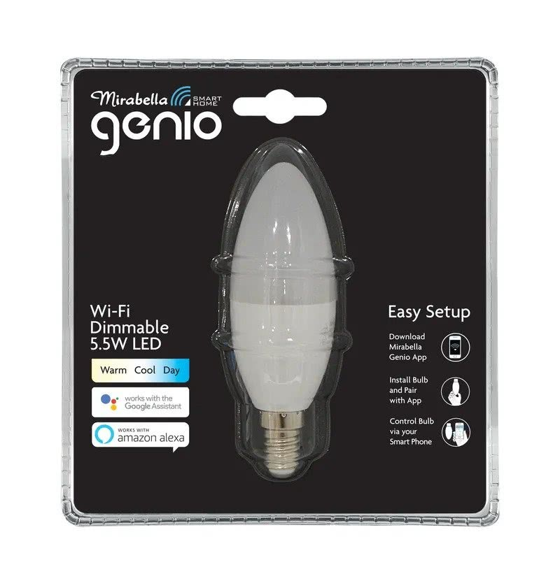

## General Notes

This page covers the Mirabella Genio Wi-Fi SES LED Candle.

[Hardware reference for the I002745 candle](https://templates.blakadder.com/mirabella_genio_I002745.html).



## GPIO Pinout

| Pin    | Function           |
| ------ | ------------------ |
| GPIO12 | Light - Warm White |
| GPIO12 | Light - Cool White |

## Basic Configuration

```yaml file=config.yaml
```

## Optional features

Download the selected YAML files into the same directory and include them as local packages alongside `config.yaml`.
Add your Wi-Fi credentials in your own configuration.

Home Assistant API and OTA updates:

```yaml file=home-assistant.yaml
```

MQTT, using an example broker hostname to replace with your own:

```yaml file=mqtt.yaml
```

Turn the light on at boot:

```yaml file=turn-on-at-boot.yaml
```

Wi-Fi signal sensor:

```yaml file=wifi-signal.yaml
```
