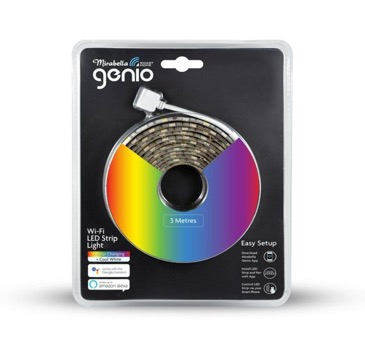

## General Notes

The [Mirabella Genio Wi-Fi LED Strip Light][2] features a row of both RGB and cool white LEDs alternating between the
two along the strip.

[2]: https://www.mirabella.com.au/products/i002579



They are sold at Kmart in a [3m version](https://www.kmart.com.au/product/mirabella-genio-wi-fi-led-strip-light/2622813)
and a [5m version](https://www.kmart.com.au/product/mirabella-genio-wi-fi-led-strip-light/2754878).

Inside is a TYWE3S module based on the ESP8266 microcontroller. It is possible to flash older units
[OTA using tuya-convert](/devices/tuya-convert) and may also work with current ones. If you attempt to flash a current
unit OTA, you should update this page specify if it's still possible or not.

![Genio Wi-Fi LED Strip Light Teardown][1]

## GPIO Pinout

| Pin    | Function      |
| ------ | ------------- |
| GPIO0  | Push Button   |
| GPIO4  | Light - Red   |
| GPIO5  | Light - White |
| GPIO12 | Light - Green |
| GPIO14 | Light - Blue  |

## Basic Configuration

```yaml file=config.yaml
```

[1]: ./Mirabella-Genio-WiFi-LED-Strip-Light_Teardown.jpg "Genio Wi-Fi LED Strip Light Teardown"

## Optional features

Download the selected YAML files into the same directory and include them as local packages alongside `config.yaml`.
Add your Wi-Fi credentials in your own configuration.

Home Assistant API and OTA updates:

```yaml file=home-assistant.yaml
```

Toggle the strip with its physical button:

```yaml file=button.yaml
```
