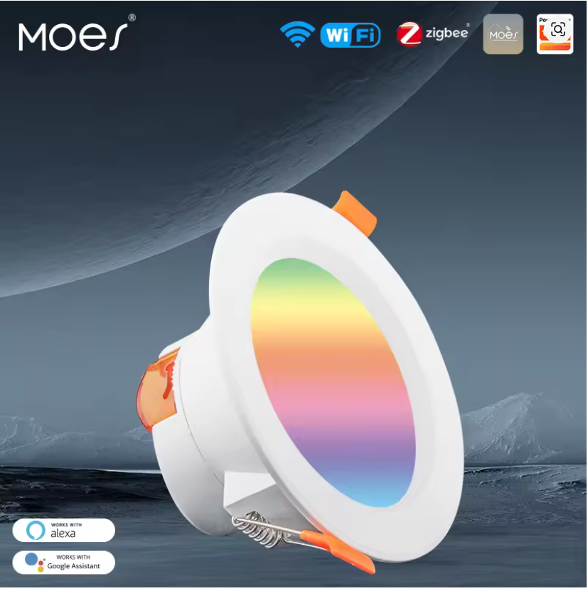
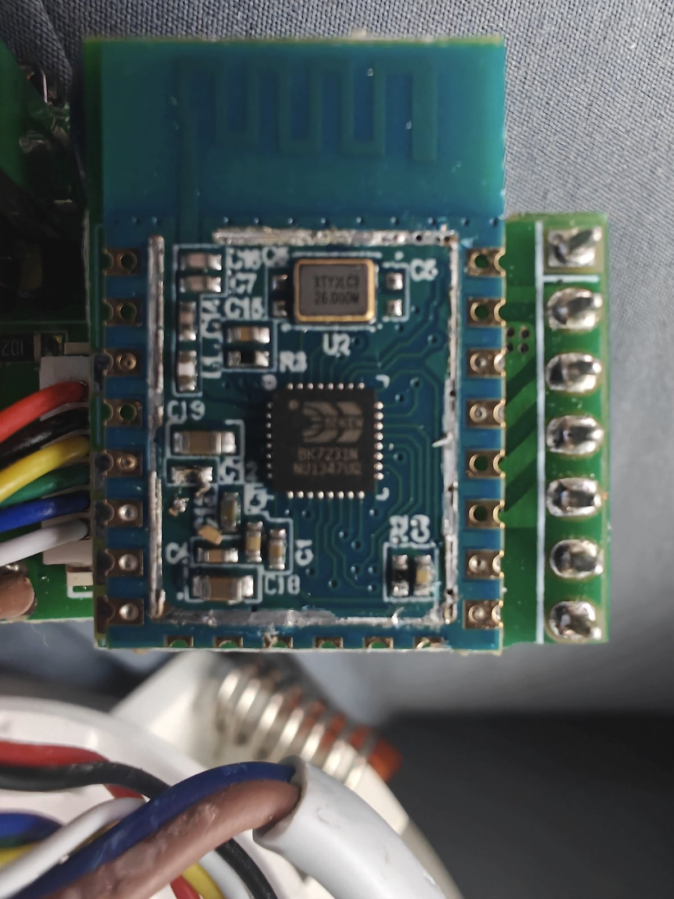
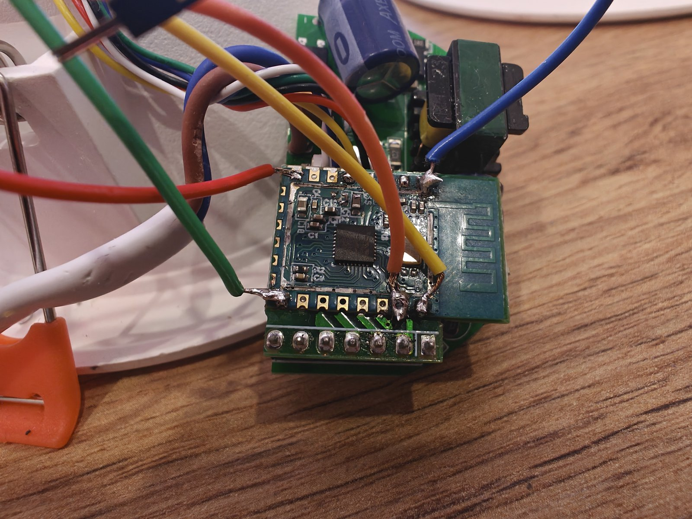

## Product Description

Recessed RGBWW (RGB + cold/warm white) downlight sold by Moes and other Tuya-based brands,
commonly found on AliExpress in two sizes (145 mm and 115 mm diameter).
Both sizes use the same board and the same firmware.

It is mains powered (220 V) and carries a Tuya CB3S module with a Beken BK7231N SoC.
The module is hidden under a metal shield with no chip name printed on the enclosure or the PCB,
so the shield has to be removed to identify it.

A capacitive touch button on the front cover toggles the light.

## Product Images





## Flashing

The CB3S module has no USB to serial chip, so the downlight has to be disassembled and
flashed via UART with [ltchiptool](https://docs.libretiny.eu/docs/flashing/tools/ltchiptool/).

Things to keep in mind with Beken chips:

1. Work with the downlight **fully disconnected from mains** and power the CB3S from an isolated
   3.3 V supply rated for at least 500 mA. Most USB-UART adapters cannot deliver that current
   reliably, and a brownout during flash erase aborts the write.
2. If the module only powers up reliably on its own board, the board must be fed from a supply that
   is galvanically isolated from mains (isolated bench supply, or a mains isolation transformer for
   the whole board). A mains-referenced supply puts hazardous voltage on GND, RX, TX and therefore on
   the USB adapter and the computer. If you have no isolated supply, put a USB isolator between the
   adapter and the computer and treat every pin as live.
   **Never connect the 3.3 V line of the USB-UART adapter while the board is powered.** Only GND, RX
   and TX go to the adapter.
3. Bridge the CEN pin to GND before powering the chip, and remove the bridge before the writing starts.
4. An order that works: power up the module, plug in the USB adapter, launch the flash command,
   wait a few seconds, then remove the CEN-to-GND bridge.

**Warning: this device works with mains voltage. Take all necessary precautions and never work on it
while it is connected to mains.**

## GPIO Pinout

| Pin | Function        |
| --- | --------------- |
| P8  | Red PWM         |
| P24 | Green PWM       |
| P26 | Blue PWM        |
| P7  | Cold white PWM  |
| P6  | Warm white PWM  |
| P14 | Touch button    |

Pin naming on Beken chips is `P6`, `P7`, `P8`..., not `GPIOxx`.
If the colors do not match on your unit, flash a diagnostic firmware with one monochromatic
light per candidate PWM pin and toggle them one by one to find the real mapping.

## Basic Configuration

```yaml file=config.yaml
```

## Links

- [CB3S pinout and documentation (LibreTiny)](https://docs.libretiny.eu/boards/cb3s/)
- [Full flashing story and photos](https://github.com/gnacho/esphome-moes-downlight-cb3s)
