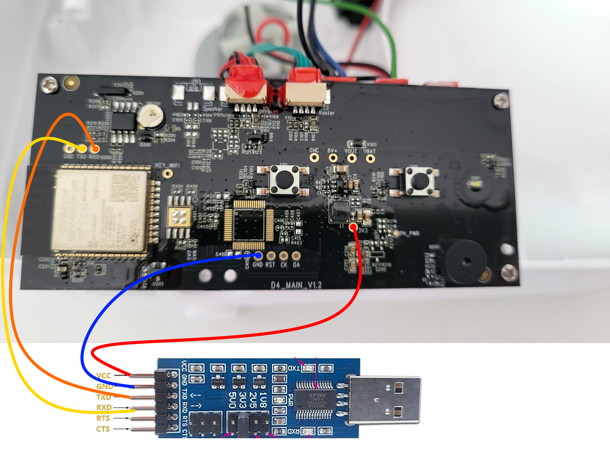
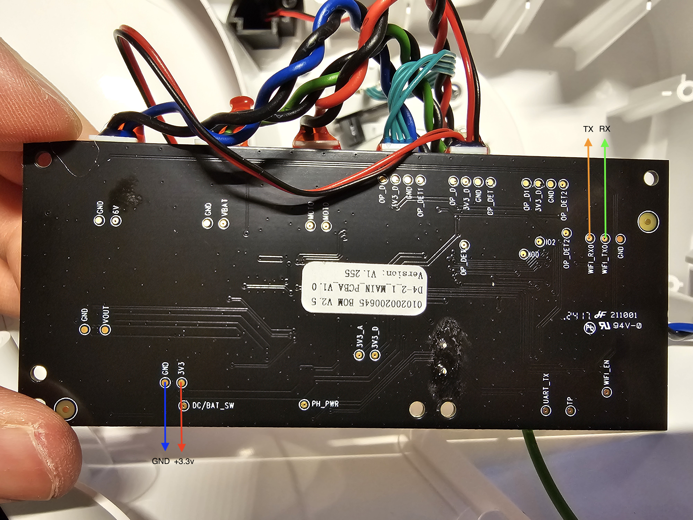

## Product description

This is an automatic pet feeder for cat/dog sized pets with a proprietary cloud based app. The mainboard has an
ESP32-WROOM-32D chip on it and thus can be flashed with an ESPHome firmware to be controlled locally.

The feeder comes with a US power adapter and a barrel connector if ordered from
[Amazon US](https://www.amazon.com/dp/B0CFV4B369), but can be powered by any 5V power adapter with a barrel connector.

Official product [page](https://petkit.com/products/fresh-element-solo).

## Dissasembly

The feeder base has to be taken apart to access the mainboard. This requires removal of four screws at the bottom side,
hidden under the rubber feet. The rubber feet have to be partially peeled off to access the screws. Once the screws are
removed, gently remove the base. Quite a lot of force may be required, as the red glue (pictured in the section below)
used to secure the connectors in place may be adhered to the base. A heat gun on low or a hair dryer might help to
loosen up the adhesive.

## Flashing

There are two (known) revisions of the mainboard:

### Revision A

See the the wiring diagram for flashing below (borrowed from the Reddit
[comment](https://www.reddit.com/r/Esphome/comments/v19c7p/comment/jvl91mi/)). Press and hold the right button (the wifi
button) while plugging the adapter in, and release after a second or two to enter boot mode.



### Revision B

This board revision is covered in silicone on the front, but there are testing pads on the bottom that can be soldered
to for flashing.



As with Revision A, hold the wifi button while plugging in the serial adapter and release after a couple seconds to
enter boot mode.

Revision B appears to otherwise have the same pinout as Revision A.

### Back up the stock firmware

Before flashing, read the whole flash so you can go back to the stock firmware. Some boards have 4 MB of flash, others 8 MB; `ALL` reads the whole chip either way:

```bash
esptool.py --baud 115200 read_flash 0 ALL petkit-stock-backup.bin
```

### Internal pinout

These roles were confirmed against the stock firmware.

| Pin    | Function                                                                    |
| ------ | --------------------------------------------------------------------------- |
| GPIO19 | Motor driver awake (low = driver asleep)                                    |
| GPIO17 | Motor H-bridge input A                                                      |
| GPIO18 | Motor H-bridge input B                                                      |
| GPIO32 | Motor current shunt (ADC1 channel 4, 0 dB)                                  |
| GPIO27 | Grate switch: low when the grate closes the outlet, once per turn           |
| GPIO14 | Outlet IR: high when something covers the beam (falling food, or a full bowl) |
| GPIO2  | Hopper IR emitter                                                           |
| GPIO13 | Hopper IR receiver: high = food low                                         |
| GPIO33 | Power for the IR sensors and the grate switch                               |
| GPIO16 | Buzzer (the stock firmware uses 2 kHz)                                      |
| GPIO5  | Status LED                                                                  |
| GPIO34 | Feed button (FUNC)                                                          |
| GPIO0  | Wi-Fi / SET button (also the boot-mode button)                              |
| GPIO21 | High when running on batteries                                              |
| GPIO39 | DC input voltage (147/47 divider)                                           |
| GPIO36 | Battery voltage (147/47 divider)                                            |
| GPIO15 | I2C SDA (PCF8563 RTC at 0x51)                                               |
| GPIO4  | I2C SCL                                                                     |
| GPIO23 | Motor driver fault line, not used by the stock firmware                     |

Motor H-bridge states (GPIO19 / GPIO17 / GPIO18):

| Command       | GPIO19 | GPIO17 | GPIO18 |
| ------------- | ------ | ------ | ------ |
| Forward       | 1      | 0      | 1      |
| Reverse       | 1      | 1      | 0      |
| Brake         | 1      | 1      | 1      |
| Driver asleep | 0      | x      | x      |

## Hardware configuration

The hardware: pins, motor outputs, sensors, ADCs and the RTC. Add your own `wifi:`, `api:` and `ota:`.

```yaml file=config.yaml
```

## Feeding logic

`feeder.yaml` goes on top of `config.yaml` and makes the feeder behave like the stock firmware. It works offline: the schedule runs from the RTC, which is set from Home Assistant or SNTP. The motor controller is pulled as an external component from the [project repository](https://github.com/Triskae/esphome-petkit-element-solo), which also documents how each behaviour was matched to the stock firmware.

- **Schedule:** 24 hourly slots (`00:00 cups` … `23:00 cups`), stored on the device.
- **Manual feeding:** `Dispense food` uses the `Manual dispense scoops` amount; `Cancel feed` stops a feed.
- **Counting:** one portion per grate turn, counted once per closure, plus one extra turn when the outlet is open at start.
- **Jam handling:** each run has a timeout of (turns + 1) × 10 s + 5 s. The motor current detects stalls. On a stall, the motor reverses 1 or 2 turns, up to 5 times, then finishes the missing portions.
  - A timeout is reported as `GRAT_ERR` (the motor turned but nothing was counted) or `BLOCK_FOOD` (food jammed).
  - A covered outlet (full bowl) is reported as `BLOCK_DOOR` (`Outlet blocked`).
- **Food level:** `Food low` comes from the hopper IR. While it is on, there are 5 beeps every 30 s, within the `Food alarm from hour` / `to hour` window. `Food low alarm` turns this off.
- **Buttons, as stock:**
  - FUNC: a click cancels a feed; hold it for about 1.5 s to feed while held. `Child lock` disables holding.
  - SET: only beeps.
- **Power:** `On battery`, `DC input voltage`, `Battery voltage`. Feeding is refused on `Power fault` (DC outside 4.5–7.0 V) or `Low battery` (batteries at 5.5 V or less).
- **Diagnostics:** `Motor fault`, `Last feed max motor current`, `Last feed un-jam attempts`, `Dispensed food scoops` (portions where food was actually seen at the outlet).

Home Assistant events, for automations and notifications:

- `esphome.feeder_food_dispensed`, with `message`;
- `esphome.feeder_food_low`, with `message`;
- `esphome.feeder_fault`, with `fault` (`GRAT_ERR`, `BLOCK_FOOD` or `BLOCK_DOOR`) and `message`.

```yaml file=feeder.yaml
```

A ready-to-use config that pulls both files and only needs your secrets is in the [project repository](https://github.com/Triskae/esphome-petkit-element-solo#quick-start).

## Disclaimer

This is an independent community project, not affiliated with or endorsed by PETKIT. PETKIT and Fresh Element are trademarks of their respective owners, used here only to identify the hardware. Flashing a custom firmware may void your warranty. Keep a backup of the stock firmware, and always check that your pet is fed.
