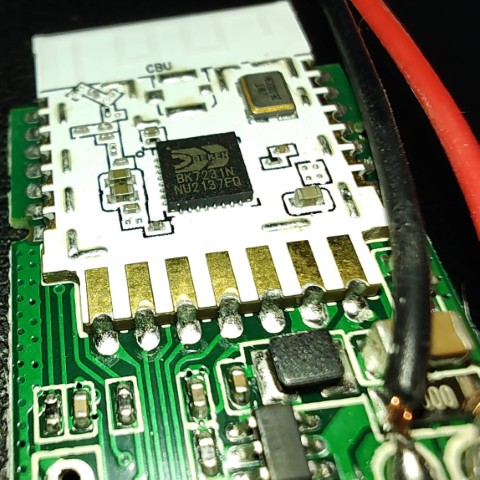
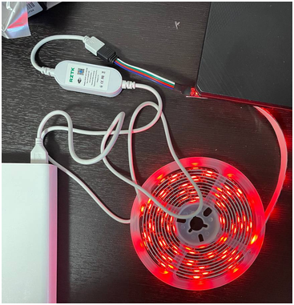

## Info

Selling in Ukraine under the name: `RZTK Smart LED 3 USB RGB`
Device name in Home Assistance or Tuya App after pairing: `SCW-WB-CB003 (dpkr4f1gvgawkmwy)`

### Hardware

The chip is: `BK7231N`

[Full info at libretiny:](https://docs.libretiny.eu/boards/cbu/)

Macro:

1. 

Device view:

1. 

#### Flash

Same as usual for such kind of chip: [beken-72xx](https://docs.libretiny.eu/docs/platform/beken-72xx/)
Note:  `...you need to bridge CEN pin to GND with a wire.`

YAML:

Add your own Wi-Fi credentials, API and OTA settings to this hardware configuration.

```yaml file=config.yaml
```
